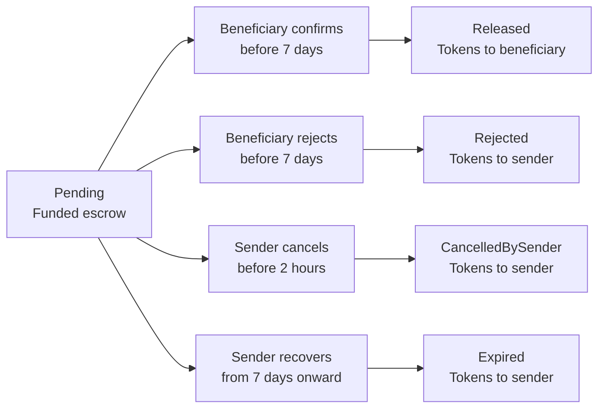
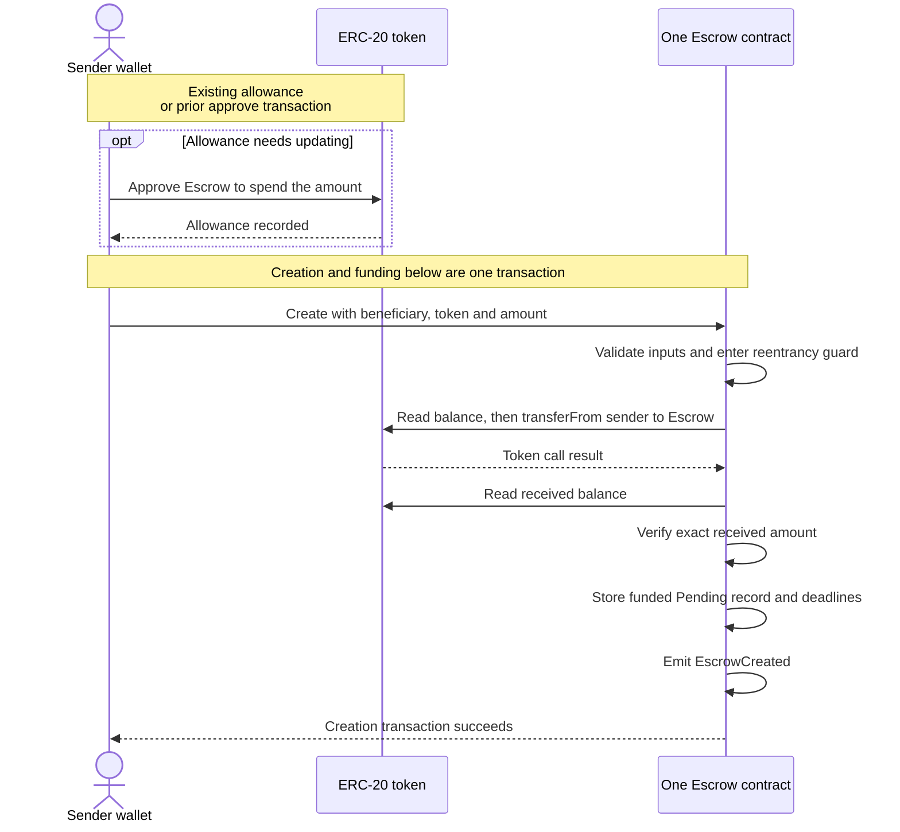
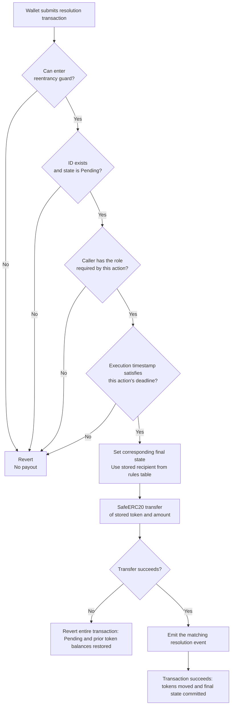
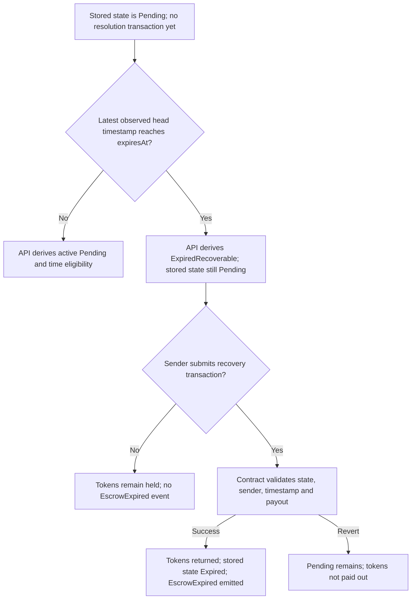

# Contract flows and token-release rules

Date: 2026-11-04. Planning diagrams, not implementation or a finalized ABI. Action names are illustrative. This document explains the [SDD](sdd/escrow.md), using the challenge's actor/time rules on pages 1-2.

These diagrams show the baseline without an emergency pause. Pause remains an [open design decision](safety-review.md), not an omitted requirement or an accepted extra gate. Any selected policy must be added explicitly to the affected flows.

## 1. What triggers tokens to leave?

An authorized party submits a **new on-chain resolution transaction**. The contract checks that the ID exists, the escrow is Pending, the caller matches that action's role, and the transaction's block timestamp satisfies its deadline. A successful token transfer completes the resolution in that same transaction.

Time alone never executes a function. The worker, API, elapsed deadline, and number of confirmations do not trigger token payouts. There is no separate withdrawal after successful confirmation: the beneficiary's confirmation transaction already transfers the tokens.

Beneficiary confirmation is a business acceptance action, distinct from the blockchain confirmations used by the indexer. Deadlines are measured from creation: `cancelDeadline = createdAt + 2 hours` and `expiresAt = createdAt + 7 days`.

| Action that triggers a payout | Caller | Time condition | Fixed token recipient | Final state |
| --- | --- | --- | --- | --- |
| Confirm / accept | Beneficiary | `block.timestamp < expiresAt` | Stored beneficiary | Released |
| Reject | Beneficiary | `block.timestamp < expiresAt` | Stored sender | Rejected |
| Cancel | Sender | `block.timestamp < cancelDeadline` | Stored sender | CancelledBySender |
| Recover expired escrow | Sender | `block.timestamp >= expiresAt` | Stored sender | Expired |

Every row also requires an existing Pending escrow. The token, amount and recipient come from that escrow's stored record. In particular, rejection pays the sender, although the beneficiary submits it. A third party cannot select a destination or execute an exit merely because time passed.

The challenge's acceptance condition is the beneficiary's decision. It does not specify an oracle, bank-settlement proof, arbitrator, or off-chain approval as a payout condition.

### Lifecycle overview

Every outgoing arrow below requires its own successful transaction. There is no automatic arrow when the clock reaches a deadline.

Released, Rejected, CancelledBySender and Expired are terminal. No second exit is possible. During the first two hours both sender cancellation and beneficiary decisions are available; the first successful transaction in canonical order wins.

## 2. Creation and funding interactions

One Escrow deployment holds many IDs. The ERC-20 contract maintains token balances; funding credits the Escrow contract's address, and resolution debits that address. The API holds no tokens or wallet signing keys.

The sequence below shows the successful path. A failed check or token call aborts immediately; later steps do not execute.

An earlier approve is a separate transaction and is not rolled back if creation later fails. The successful creation has no intermediate unfunded escrow. Baseline deposits require the requested amount to equal the amount received; standard and no-return transfer behavior must work.

## 3. Checks on every token exit

This is the logical decision flow; exact ABI and custom-error precedence remain implementation details. `t` below is the timestamp of the block executing this resolution, not the API host's clock.

Setting the final state before the external payout and guarding reentrancy protect against repeated/cross-action callbacks. The state change is committed only if the transaction succeeds. A failed payout reverts both the state change and token movements from that transaction; it does not consume the escrow's one successful resolution.

## 4. What does time enable?

| Time since creation, while still Pending | Sender may do | Beneficiary may do | Does time alone transfer tokens? |
| --- | --- | --- | --- |
| From creation to strictly before 2h | Cancel | Confirm or reject | No |
| From exactly 2h to strictly before 7d | No exit action yet | Confirm or reject | No |
| From exactly 7d onward | Recover | No resolution action | No |

The beneficiary can accept at minute 1 and receive the tokens then. The 2-hour cancellation window is not a mandatory waiting period before acceptance. At exactly 2h cancellation is closed; at exactly 7d acceptance/rejection close and recovery opens.

### Expiry without a transaction

The worker observes the resulting events and waits for the configured admission delay before updating its projection. That indexing delay is independent of the transfer: successful on-chain resolution already moved the tokens. API fields describe the indexed observation, which can lag the current chain.

## 5. Concrete scope examples

- Alice creates an escrow for Bob with 100 units. Bob confirms one minute later: the contract transfers 100 to Bob and records Released. Alice can no longer cancel, even though two hours have not passed.
- Bob rejects at hour 3: the contract returns 100 to Alice and records Rejected. The sender's cancellation deadline does not restrict beneficiary rejection.
- Nobody acts for seven days: the stored record remains Pending and the tokens remain held. The API reports ExpiredRecoverable. Alice must submit recovery; only successful recovery records Expired and returns the tokens.
- Alice's cancellation and Bob's confirmation compete in the first two hours: one succeeds first; the other reverts because the escrow is already final. Both payouts cannot occur.

All amounts here assume the supported simple token semantics. This is a behavioral specification and explanation, not evidence of executed tests or deployed contracts.
