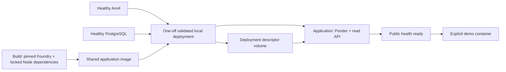

# Complete Docker startup and lifecycle demo

This is the S4 reviewer path. It runs Anvil, PostgreSQL, local deployment, Ponder and the read API through Docker Compose. Host Node/npm/Foundry are not needed. Existing host development commands remain available in [local development](local-development.md).

## Prerequisites and startup

Use a running Docker engine with a recent Compose CLI and a checkout with the pinned Solidity submodules initialized. Local verification used Docker Engine 29.1.3 / Compose 5.0.0; no minimum older-version compatibility is inferred:

```sh
git submodule update --init --depth 1
docker compose --profile app up --build --wait --wait-timeout 120
```

The Compose command is the single full startup command after obtaining the source. A first build needs network access for pinned images, locked npm packages and the Solidity compiler. No .env file or private key is required. The command waits for actual GET /health readiness, rather than just a listening port. On failure, inspect `docker compose --profile app logs --tail 100 deploy application`.

The API is available at http://127.0.0.1:3000. Only its port is published, on loopback. Anvil, PostgreSQL and Ponder's native listener remain internal. To select another host API port, set API_PORT before the command; the container API remains on 3000. For example:

```sh
export API_PORT=3001
docker compose --profile app up --build --wait --wait-timeout 120
```



Foundry compiles the contracts in a build stage. The final non-root Node image contains only the artifacts, runtime dependencies/application and canonical OpenAPI file. Deployment, application and demo share that image; only deploy owns its build declaration, avoiding concurrent exports of the same image tag. The runtime has no Docker socket, host source mount or signing-key file. The application mounts deployment metadata read-only. Ponder remains the sole database writer through its existing adapter.

## Run the demo

After startup:

```sh
docker compose --profile app run --rm --no-deps demo
```

The demo command deliberately uses --no-deps: it does not recreate the running application using a different shell's port/policy settings. Keep chosen configuration exported in the same shell, or persist it in .env for future up commands. Demo preflight verifies live API readiness and matching admission delay before sending any transaction; mismatched demo settings fail without changing the application or sender nonce.

The demo uses the first two unlocked local Anvil accounts. Its RPC/API destinations are restricted to the named Compose services and it checks chain/deployment/build identity before any transaction. It mints the test-only MockERC20, approves 40 raw units, and creates four distinct 10-unit deposits. It then:

1. Cancels the first as sender, confirms the second as beneficiary, and rejects the third as beneficiary.
2. Advances only Anvil's timestamp to the fourth deposit's expiry, mines a block and enough additional blocks for CONFIRMATION_DELAY.
3. Verifies the fourth is still Pending on chain and ExpiredRecoverable through the API, canRecover=true, canCancel=false, no resolution transaction, and tokens still escrowed. Checks the filtered list too.
4. Recovers it as sender, mines the configured additional blocks and waits for the admitted Expired result.
5. Verifies every payout's actual recipient/balance change, all four contract getter states against API outcomes, parties/token/amounts and creation/resolution hashes against receipts. Full-round-trip balances are sender +30, beneficiary +10, escrow unchanged. Final API policy/lag/backlog match the configured additional-block delay.

Successful output is JSON with result=pass, the four outcomes, transaction hashes, pre-recovery observation and final progress/balances. IDs come from actual creation events. Repeating the demo creates new IDs and does not reinterpret earlier deposits. The demo changes local chain time by approximately seven days each run; it does not change the host clock. Run it serially because Anvil's time/mining are global to that project.

Startup does not run the demo automatically. Ordinary application restarts neither mint tokens nor replay wallet transactions. The deploy job validates/reuses its descriptor without redeploying; changing the packaged Escrow build requires an explicit new deployment/session, rather than relabeling existing data.

## Read and operate the application

```sh
curl http://127.0.0.1:3000/health
curl 'http://127.0.0.1:3000/escrows?limit=20'
curl http://127.0.0.1:3000/openapi.yaml
docker compose --profile app logs --tail 100 application
docker compose --profile app restart application
```

Use a returned ID for GET /escrows/{id}; empty startup has no deposit yet. See [OpenAPI/HTTP semantics](api/README.md). The API binds 0.0.0.0 inside its container for port forwarding; the host binding remains 127.0.0.1. Host development still defaults to a loopback listener. Binding configuration does not change persisted projection scope.

CONFIRMATION_DELAY remains configurable, default 2 additional blocks after inclusion. Compose startup/deployment and the demo use the same value. REORG_WINDOW_SECONDS, INDEXER_POLL_MS and INDEXER_SCHEMA retain their existing meanings. Exported values override matching .env interpolation; no remote RPC/database URL from .env is used for this local fixture. Changing persisted admission/recovery policy requires a fresh explicit scope/session, as explained in the [runtime guide](indexer-runtime.md).

### Disposable sessions and explicit reset

Application-only restart preserves deployment, database and outcomes while Anvil continues running. PostgreSQL and the descriptor have named volumes; the Anvil chain remains ephemeral, as in the original foundation. Stopping/recreating Anvil can lose its chain while those volumes remain. Startup refuses a mismatched descriptor/history; it never wipes the database automatically.

For a deliberately fresh disposable session, remove only the selected Compose project's resources and start again:

```sh
docker compose --profile app down --volumes --remove-orphans
docker compose --profile app up --build --wait --wait-timeout 120
```

If stop, down or a Docker restart loses the Anvil session and startup reports deployment_identity_mismatch, inspect the retained data and use the explicit reset above when choosing a new disposable session. The reset command deletes that project's PostgreSQL/descriptor volumes. Keep the same project selection (including any explicit -p or COMPOSE_PROJECT_NAME) across commands. This does not affect the older remitee-local host-development project or unrelated Compose projects. No durable chain archive or transparent recovery after an Anvil reset is promised.

## Verification

`npm run app:test` (or `node scripts/compose-acceptance.ts`) is a dependency-free host test driver for the Docker-only reviewer path. It creates an isolated remitee-app-check-* project with an ephemeral loopback API port, runs the real startup/demo and checks restart/failure/refusal behavior, then removes only its containers/network/volumes. It requires Node only to drive assertions; operators use the Compose commands above without Node. CI uses the same driver without npm ci on the host.

The [November 9 implementation record](outputs/codex/2026-11-09-docker-startup.md) owns actual results, discovered issues, assumptions and residual limits. CI configuration is distinct from observing a published workflow. S5 candidate rehearsal/final submission remains separate.

Primary references: [Compose readiness/dependency conditions](https://docs.docker.com/compose/how-tos/startup-order/), [multi-stage builds](https://docs.docker.com/build/building/multi-stage/).
