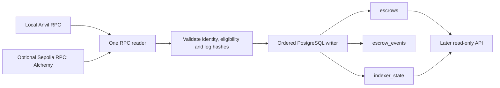

# Indexer design and provider options

Date: 2026-11-06. Status: the local Ponder PoC is complete and RPC polling is selected; no production indexer or domain migration is implemented. Refines S2/AC6-AC8 in the [canonical SDD](sdd/escrow.md), tracked in [#4](https://github.com/dubzn/remitee-challenge/issues/4). Schema details are in [PostgreSQL models](postgres-models.md).

## Existing plan and desired behavior

The initial design already exists in the SDD's event-processing boundary and [recovery spike](spikes/002-indexing-recovery.md). This document makes the worker, provider choices and local/testnet boundary explicit.

Observe the five frozen events from [IEscrow](../contracts/src/IEscrow.sol). Build a durable query model, resume after a crash, avoid duplicate state changes and expose how far observation has progressed. This worker never signs, creates, funds or resubmits transactions. The chain remains authoritative; PostgreSQL contains a rebuildable projection.

## Recommendation and alternatives

The current SDD baseline proposes one TypeScript worker using viem's public RPC actions and the existing `pg` dependency. The authorized Ponder proof has now been executed; retain this polling baseline after the measured admitted-reorg/readiness mismatch. See [results and decision](outputs/codex/2026-11-06-ponder-poc.md). Use Anvil locally; optionally use Alchemy's Sepolia RPC for a later testnet deployment. This is a recommendation, not a claim that a custom engine is required by the challenge or that a framework is inferior. viem exposes read-only public actions and HTTP transports; it does not supply our durable projection protocol. [Client/action documentation](https://viem.sh/docs/clients/intro).

| Option | Local Anvil | Testnet | What it supplies | Work still owned by this application |
| --- | --- | --- | --- | --- |
| viem + bounded polling + PostgreSQL | Same worker against local RPC | Same worker against a supported RPC, including Alchemy Sepolia | Typed RPC reads and ABI decoding; our small persistence/recovery loop | Ordering, admission delay, journal/projection/checkpoint transaction, writer exclusion, health and tests |
| Alchemy Custom Webhooks | A local HTTP receiver can receive hosted-chain notifications through a reachable URL; this is not an Anvil indexer | Hosted supported networks; verify product/network availability | Filtered contract-event push delivery | Authenticated ingress, durable acknowledgement, deduplication, catch-up/reconciliation and the PostgreSQL model |
| Ponder, self-hosted | Official Foundry/Anvil integration | Configurable chain ID and RPC endpoint | Indexing engine, typed handlers, PostgreSQL integration and recovery mechanisms | Escrow business projection, required API/time semantics, configuration and acceptance evidence; reevaluate engine-owned state |
| Alchemy Subgraphs | Not a current option | Not a current option | Product discontinued | Select a different service/framework rather than integrating retired endpoints |

**Alchemy Subgraphs was sunset on December 8, 2025; its query endpoints were discontinued.** This does not mean Alchemy RPC or Custom Webhooks were discontinued. [Official deprecation notice](https://www.alchemy.com/docs/alchemy-subgraphs/deprecation-notice).

### Using Alchemy without a second indexing design

Alchemy RPC exposes standard Ethereum JSON-RPC. Its Sepolia endpoint can supply blocks/logs to the same reader used with Anvil. Changing networks also requires a new verified deployment identity and its own data scope; changing only the URL while retaining another chain's projection is unsafe. [RPC overview](https://www.alchemy.com/docs/chains), [Sepolia configuration](https://www.alchemy.com/docs/choosing-a-web3-network).

Our worker would call `eth_chainId`, `eth_getBlockByNumber`, `eth_getCode` during identity validation and `eth_getLogs` for the configured contract/event topics. Range size and request rate must respect the selected provider/plan. Do not copy older unlimited-range assumptions: the current endpoint documentation has plan-specific caps. Retry reads with bounded backoff; a rejected/oversized range never advances the cursor. No Alchemy-specific SDK is required for standard JSON-RPC. [Current getLogs reference](https://www.alchemy.com/docs/chains/ethereum/ethereum-api-endpoints/eth-get-logs).

Alchemy webhooks instead push to an HTTP receiver and require signature validation. Its documented ordering assurance covers first deliveries; finite delivery retries are not a durable cursor for this application. We would still need reconciliation for gaps and restarts. A tunnel to a local receiver does not connect the hosted service to our private Anvil chain; that distinction follows from the hosted-network/receiver architecture. [Custom Webhooks](https://www.alchemy.com/docs/reference/custom-webhook), [delivery and signature behavior](https://www.alchemy.com/docs/reference/notify-api-quickstart).

### Ponder is a viable local and testnet alternative

Ponder explicitly supports Anvil. Its guide disables `cacheRpcRequests` for local chains that reset; its database guide supports an external PostgreSQL server in local development. A different configured chain/RPC supplies the testnet environment. [Foundry guide](https://ponder.sh/docs/guides/foundry), [database guide](https://ponder.sh/docs/database), [chain configuration](https://ponder.sh/docs/config/chains).

Ponder owns synchronization/cache/checkpoint and schema lifecycle. Its current chain configuration includes automatic recovery within a reorg window, which differs from our proposed halt-and-validated-replay policy. Neither its development hot reload nor a configurable reorg window alone proves our AC6-AC8 behavior. Do not write our own cursor into Ponder's internal tables or run both engines for the same projection. [Chain recovery settings](https://ponder.sh/docs/config/chains), [self-hosting and crash recovery](https://ponder.sh/docs/production/self-hosting).

The [bounded proof](spikes/004-ponder-poc.md) was performed with Ponder 0.18.5, actual PostgreSQL/Anvil and the real contract. It passed persistence, restart, hard-kill and shallow-fork probes. Native readiness and a small guard still served an orphan Released outcome after a verified admitted reorg. Retain polling for this deliverable; [#10](https://github.com/dubzn/remitee-challenge/issues/10) tracks possible future hardening. This is a finding about the tested integration, not a general rejection of framework reuse.

### Comparison with Dojo Torii

Torii's close integration comes from knowing the Dojo World/model protocol: it discovers registered models and projects standardized events into queryable state. The closest architectural analogue on EVM is **MUD plus its Store indexer**, which replicates MUD Store events into relational data. This is a comparison of architecture, not a claim of API or feature parity. [Torii documentation](https://github.com/dojoengine/book/blob/main/docs/pages/toolchain/torii/index.md), [MUD indexer](https://mud.dev/indexer).

Our Escrow is a conventional Solidity contract, not a MUD World/Store. Adopting that protocol would change the already completed contract design. For the existing contract, **Ponder** is the first reusable engine to evaluate under the bounded proof above: define the off-chain schema and five event handlers, and reuse its indexing/database/query machinery. Its schema relations feed GraphQL, but they do not themselves create database foreign-key constraints; do not assume the physical model in postgres-models.md is installed automatically. [Ponder schema/GraphQL relations](https://ponder.sh/docs/schema/relations).

**Envio HyperIndex** is another event/schema/GraphQL indexing framework with local Docker and self-hosting options. Treat it as a second candidate, not an executed Anvil integration: its data-source/authentication requirements need verification for a fully local RPC path. [HyperIndex overview](https://docs.envio.dev/docs/HyperIndex/overview).

The distinction is model-aware automatic synchronization versus a generic event-indexing engine with application-defined projections. For either generic framework, the required escrow GET endpoints, chain-time eligibility and acceptance tests remain application responsibilities. Engine-managed synchronization should replace our handwritten worker responsibilities, not run alongside a second competing cursor. The proof is now complete: Ponder is installed only in the isolated experiment and was not adopted for the application. The polling fallback is selected.

## Proposed worker flow

Local and testnet are alternative configurations, not two simultaneous workers or mandatory multichain support. RPC reads may be asynchronous, but one coordinator commits ranges in order. Bounded parallel prefetch remains a later response to measured RPC bottlenecks.

1. Load a pinned deployment descriptor: expected chain ID, genesis hash, contract address, deployment block/hash and ABI/schema version. Verify it against RPC; never infer identity from chain ID/address alone. Deployment tooling will produce this descriptor in a later slice.
2. Acquire a PostgreSQL session advisory lock for this deployment on a dedicated worker connection. Validate persisted metadata/checkpoint before resuming. A second writer remains unready; losing the session requires stopping and reacquiring/validating.
3. Poll the latest header, even when block height is unchanged. Capture number/hash/chain timestamp. Compute `eligibleHead = head - confirmationDelay`; no range is processed when this lies before deployment. Local demo proposes two additional blocks after inclusion; this is not consensus finality.
4. Start at deployment block when the cursor is empty, otherwise `indexedThrough + 1`. Freeze an inclusive bounded range end before fetching logs. Validate the previous checkpoint and canonical headers for every event-bearing block; sort by block number, transaction index and log index.
5. Recheck canonical range-end identity at the commit boundary. In one database transaction, verify the expected predecessor, insert only new events, apply their transitions and store the range-end block/hash. An empty range still advances the checkpoint. All statements use the same client; failure rolls everything back. [node-postgres transaction requirement](https://node-postgres.com/features/transactions).
6. Persist the successful observation/error metadata without inventing chain events. Continue at the next range. Report confirmation lag separately from `max(0, eligibleHead - indexedThrough)` work backlog.

No protocol can atomically commit PostgreSQL and an external chain. A reorg after the final RPC check remains possible; the next hash validation must halt reads/indexing. Trust in the RPC's completeness/honesty is explicit.

## Failure and replay examples

| Situation | Required result |
| --- | --- |
| Cursor 100; processing 101-110; crash before commit | Events, projection and cursor roll back; restart retries from 101 |
| Same range committed before the crash | Cursor is 110; restart begins at 111, including an event-free range |
| Same admitted event received again | Verify identical metadata/payload; no second projection mutation |
| Old range or stale expected predecessor | No cursor regression; a wholly old range is a no-op, while a stale attempt to extend is rejected |
| Overlap extends the cursor | Existing prefix is verified, only the tail beyond the current checkpoint is applied; a previously absent prefix event is a history inconsistency |
| Event's block hash conflicts before admission | Do not commit the range; validate canonical history and follow the SDD's safe halt policy |
| Stored admitted checkpoint/anchor differs from verified canonical hash | Halt/unready; explicitly validate deployment and reset/replay the disposable projection under the writer lock |
| Timeout, missing header or head behind cursor | Observation unavailable/unready; no cursor movement, no claim that a reorg was proven and no automatic deletion |

Only eligible canonical events enter the baseline journal. A transaction waiting for confirmation is different from an escrow with recorded `Pending` status. A second provisional store, webhook ingestion path or broker is outside this recommendation.

## Configuration boundary

These are proposed configuration inputs, not implemented environment variables or runnable commands.

| Input | Local | Optional testnet |
| --- | --- | --- |
| RPC endpoint | `http://anvil:8545` inside Compose, loopback endpoint from host | Private Alchemy Sepolia RPC URL supplied outside Git |
| Expected chain | 31337 | 11155111 for Ethereum Sepolia |
| Deployment descriptor | Fresh local address and canonical deployment anchor | Separately deployed/validated address and anchor |
| Database | Disposable session matching local chain | Separate database/data scope; never reuse local rows |
| Delay/range/polling | Explicit, test-controlled; demo mines extra blocks | Explicit, provider-aware; no production finality depth selected |

Testnet deployment remains optional and is not executed by this documentation task. Live testnet cannot replace deterministic crash/reorg/time-travel tests on isolated Anvil/PostgreSQL.

## Implementation gates

- [x] Candidate authorized the Ponder PoC with polling fallback; evidence selects polling, with experimental dependencies isolated.
- [ ] Implement the [three PostgreSQL models](postgres-models.md), validation and one atomic range writer.
- [ ] Prove duplicate/replay, stale predecessor, empty range, overlap, crash/restart and competing-writer behavior against PostgreSQL (AC6-AC7).
- [ ] Prove delay N-1/N/N+1, pre-admission fork handling, admitted mismatch halt, unavailable RPC and explicit validated replay against Anvil/PostgreSQL (AC8).
- [ ] Run the actual suite in CI before claiming the November 6 indexer block complete.

Provider/framework capability statements were checked in primary documentation on Nov 6, 2026. The isolated Ponder proof and dependency installation are recorded separately; no provider subscription or throughput benchmark was performed. The recommendation is an engineering inference for one contract/five events and this delivery window.
