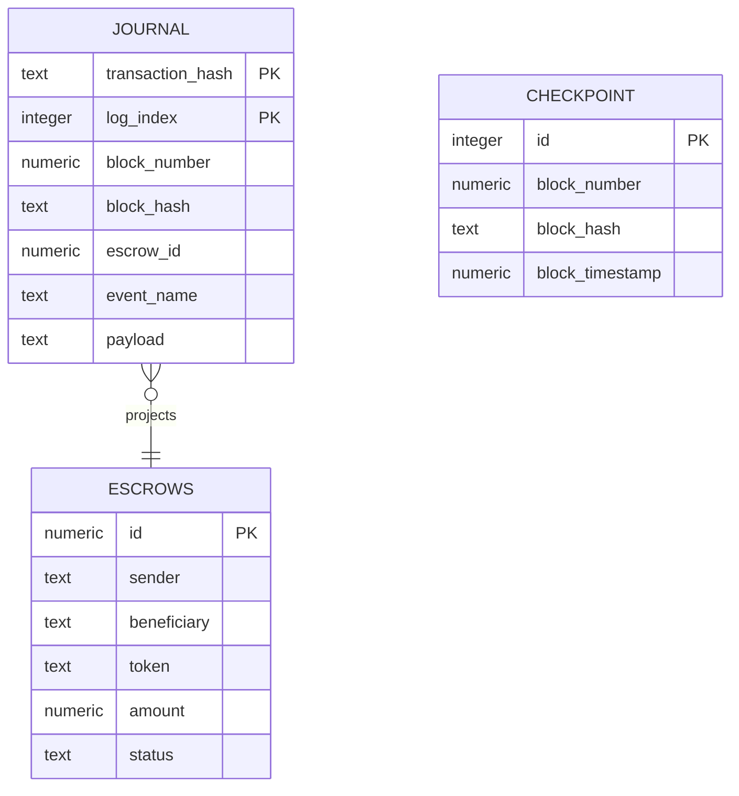
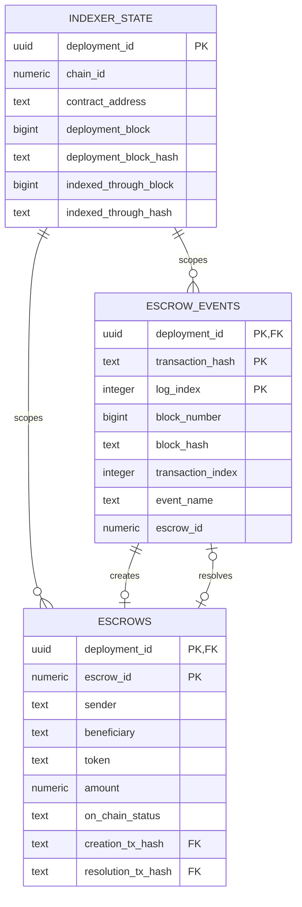

# PostgreSQL models for escrow observation

Date: 2026-11-06. **Selected engine: Ponder 0.18.5.** The [executed follow-up](outputs/codex/2026-11-06-ponder-decision.md) closes engine selection, not production migration/acceptance. The earlier polling DDL proposal is archived below; do not install its independent cursor and lock on top of Ponder.

## Selected Ponder model

Use one verified deployment/data scope per schema, with separate local/testnet databases. A pinned deployment descriptor identifies chain ID, genesis, contract address, deployment block/hash and compatible ABI/schema. Validate it before reuse and before public reads. Ponder owns schema lifecycle and internal sync/reorg metadata; application code must not edit those tables. Rebuild only an explicitly selected disposable scope against validated canonical history.

| Application table | Fields and ownership |
| --- | --- |
| escrows | ID primary key; sender, beneficiary, token, amount, createdAt, cancelDeadline, expiresAt and recorded status. Insert on creation; legal terminal events update Pending exactly once. |
| journal | Transaction hash + log index primary key within the validated deployment schema; block number/hash, escrow ID, event name and normalized argument payload. New event and projection participate in one framework transaction. |
| checkpoint | One fixed-key row with projected block number/hash/timestamp, updated through a public block handler including empty blocks. This is application-visible progress, not a second engine cursor. |
| Framework metadata | Durable sync position, writer lock, transaction/rollback log and lifecycle are owned by Ponder. No application SQL against private internals. |

The diagram shows logical relationships, not automatically installed SQL foreign keys. The actual experiment schema is in experiments/ponder-poc/ponder.schema.ts. uint256 IDs/amounts remain BigInt/lossless database values and decimal strings over HTTP; the fixture verified 2^200, not every numeric boundary. Deadlines and derived eligibility keep the existing chain-time rules. No scheduled synthetic expiration event or persisted second balance is added.

## Transaction and query contract

The domain projection depends on ProjectionStore. Its Ponder adapter uses the current context.db only. Find the event identity; an identical stored position/hash/payload is a no-op, while conflicting content is an error. Append a new journal row and apply its escrow mutation together. Never send these writes to a separate pg pool or the read API. Ponder progress and rollback remain framework-owned.

The proof killed the process after append but before projection: neither event nor escrow committed, and checkpoint remained before that event block. Restart reached the expected counts without duplication. A separate committed-event redelivery skipped projection; a conflicting payload was rejected. This demonstrates the failure paths using actual PostgreSQL, not an in-memory deduplication set.

The read adapter obtains projection and checkpoint in one SQL statement or repeatable-read read-only transaction. Then it checks current deployment/canonical hash against RPC. Public data and health return 503 if verification fails. A canonical older prefix is permitted with explicit progress/backlog; native /ready does not establish canonical application state. Beyond-window recovery requires explicit validated replay; within-window rollback is managed by Ponder.

## Remaining production work

Promote the selected schema and port/adapter to the application, preserve actor and successful-transaction trace fields, add required query indexes after defining actual filters, prove full numeric/trace/query behavior, expose public health and run acceptance in CI. Only the isolated experiment has created these tables so far. Keep a separate read query adapter; the existing pg dependency can serve reads without competing with the engine writer. No production migration is claimed.

## Archived polling alternative

Everything below describes the previous handwritten polling proposal. Its cursor-predecessor protocol, application advisory lock, conflict-returning SQL and replay/reset procedure apply only if a later deliberate decision replaces Ponder. They are not additional requirements for the selected engine. Links to the canonical SDD now refer to the Ponder plan.

### Purpose and relationships

`indexer_state` identifies a validated deployment and records progress. `escrow_events` retains admitted successful contract events. `escrows` is the current query projection built from those events. PostgreSQL does not custody tokens or authorize payouts.

The event references in the diagram also include `deployment_id` and their respective log indices. A creation event identifies one escrow; a resolution reference is optional until that escrow reaches a terminal outcome. Event type and actor validity are enforced by the writer, not inferred from an arbitrary foreign key.

### Shared representations

| Value | Proposed storage | Rules |
| --- | --- | --- |
| Deployment identity | `UUID` | Stable internal scope for a verified deployment, reused on restart; not the escrow's on-chain ID |
| Chain ID, escrow ID, raw token amount | `NUMERIC(78,0)` | Explicit `0..2^256-1` bounds; escrow IDs/amounts strictly positive; no floating point |
| Creation/deadline/observed chain seconds | `NUMERIC(20,0)` | Exact `0..2^64-1` bounds; full uint64 does not fit signed PostgreSQL BIGINT |
| Block numbers | `BIGINT` | Nonnegative, explicitly bounded to PostgreSQL's signed 64-bit range; parse as bigint/string in TypeScript |
| Transaction/log positions | `INTEGER` | Nonnegative; reject out-of-range RPC input rather than truncating |
| Addresses | `TEXT` | Lowercase `0x` plus exactly 40 hex digits; normalize validated input, not token symbols |
| Block/transaction/genesis hashes | `TEXT` | Lowercase `0x` plus exactly 64 hex digits |
| Operational timestamps | `TIMESTAMPTZ` | Poll, ingestion and commit wall-clock time; never used for escrow eligibility |
| Status/event names | `TEXT` with `CHECK` | Fixed allowed values from the compiled ABI; no additional Pending transaction state |

`NUMERIC(78,0)` alone does not enforce uint256 bounds. Its upper bound must be `115792089237316195423570985008687907853269984665640564039457584007913129639935`; uint64's is `18446744073709551615`. PostgreSQL can round fractional input to a declared numeric scale: the application must validate unsigned integer text before binding, not rely on scale zero to reject fractions. [PostgreSQL numeric rules](https://www.postgresql.org/docs/17/datatype-numeric.html).

Bind large values as canonical decimal strings and perform arithmetic with TypeScript bigint. Keep `pg` reads lossless using explicit text casts/parsers; never install a blanket numeric-to-Number parser. IDs/amounts are decimal strings in JSON. Existing API examples use JSON numbers for Unix seconds; S3 must explicitly define safe-range handling or revise those examples to strings before exposing out-of-safe-range uint64 values. This storage proposal never silently narrows them. [node-postgres type handling](https://node-postgres.com/features/types).

### Model 1: indexer_state

One row per registered deployment; the current application selects one deployment, not a multichain aggregation service. Chain ID/address alone cannot select a previous session safely.

| Column(s) | Type / nullability | Purpose |
| --- | --- | --- |
| `deployment_id` | UUID, PK | Stable FK scope for all child rows |
| `chain_id`, `genesis_hash` | uint256 numeric / hash, NOT NULL | Expected network identity; genesis is additional evidence, not sufficient alone |
| `contract_address` | Address, NOT NULL | One Escrow emitter; logs must match it before insertion |
| `deployment_block`, `deployment_block_hash` | BIGINT / hash, NOT NULL | Canonical deployment anchor; revalidate on startup and each scan |
| `abi_version`, `schema_version` | TEXT / INTEGER, NOT NULL | Application-accepted decoding/schema versions; reject unsupported values |
| `confirmation_delay` | INTEGER, NOT NULL, nonnegative | Additional blocks required before event admission; change only through an explicit compatible configuration/replay decision |
| `indexed_through_block`, `indexed_through_hash` | BIGINT / hash, both NULL or both set | Inclusive end of the last fully committed range; NULL means no range committed yet |
| `observed_head_number`, `observed_head_hash`, `observed_head_timestamp` | BIGINT / hash / chain seconds, all NULL or all set | Last successfully captured head observation, distinct from indexed progress |
| `lifecycle` | TEXT, NOT NULL | `initializing`, `running`, `rebuilding`, or `halted`; does not by itself prove current readiness |
| `last_poll_at`, `last_rpc_success_at`, `last_commit_at` | TIMESTAMPTZ, nullable until applicable | Operational history; last commit changes only with a committed range |
| `last_error_code`, `last_error_message` | TEXT, both NULL or both set | Sanitized diagnostic state; never persist RPC credentials in errors |
| `updated_at` | TIMESTAMPTZ, NOT NULL | Metadata modification time |

Proposed uniqueness: `(chain_id, genesis_hash, contract_address, deployment_block_hash)`. The deployment number/hash are validated together against the deployment descriptor; an existing row is never repointed at another chain or contract.

No sentinel `-1` checkpoint is needed. With a NULL cursor, the next range starts at `deployment_block`; otherwise it starts at `indexed_through_block + 1`. Validate the deployment anchor even before the first range is eligible. Enforce cursor bounds relative to deployment and its captured compatible head; the cursor normally never decreases.

After a process restart, persisted `running` and old head metadata are insufficient to serve reads. Require current RPC identity/hash validation and writer ownership. A poll failure or lost DB connection makes the process unready even if it cannot persist the failure. Successful polls with no eligible work may update observation metadata without changing the cursor. No stale operational flag is a consensus guarantee.

### Model 2: escrow_events

Only canonical events that passed the chosen admission delay enter this journal. It is append-only during normal operation, not a task queue or a complete record of wallet attempts.

| Column(s) | Type / nullability | Purpose |
| --- | --- | --- |
| `deployment_id` | UUID, FK, NOT NULL | References the validated indexer_state row |
| `transaction_hash`, `log_index` | Hash / INTEGER, NOT NULL | Together with deployment_id, the primary event identity |
| `block_number`, `block_hash` | BIGINT / hash, NOT NULL | Canonical position and fork identity, checked against the event's block header |
| `transaction_index` | INTEGER, NOT NULL | Deterministic ordering within a block |
| `event_name` | TEXT, NOT NULL | One of EscrowCreated, EscrowCancelled, EscrowReleased, EscrowRejected, EscrowExpired |
| `escrow_id` | Positive uint256 numeric, NOT NULL | Decoded ID, validated against the raw log |
| `topics`, `data` | TEXT[] / TEXT, NOT NULL | Validated raw event topics and hex data; decode with the pinned ABI, not an untyped JSON amount |
| `ingested_at` | TIMESTAMPTZ, NOT NULL | Observation/audit time, not chain execution time |

Primary key: `(deployment_id, transaction_hash, log_index)`. Add uniqueness for `(deployment_id, block_number, log_index)` to reject conflicting canonical positions, plus an ordered replay index on `(deployment_id, block_number, transaction_index, log_index)`. The scope FK avoids repeating chain ID/emitter on every row; both are validated before insertion.

Use `ON CONFLICT DO NOTHING RETURNING` for the explicit primary identity. Returned keys identify new rows; their return order is not the application order. An existing identity must match block/transaction position, hash, name, ID and raw payload exactly. A collision with different data is an inconsistency, not a harmless duplicate or an overwrite. A distinct-key canonical-position conflict also aborts the range. [INSERT/RETURNING behavior](https://www.postgresql.org/docs/17/sql-insert.html).

Retain raw topics/data and ABI version rather than creating a second generic decoded-JSON source of truth. No `processed`, retry counter or worker claim fields are needed: insertion and projection happen in the same range transaction. An inserted-but-unapplied committed event would violate the model.

### Model 3: escrows

This table supports detail and filtered/paginated lists. It stores emitted facts and the latest admitted outcome; it does not store a second balance or issue payouts.

| Column(s) | Type / nullability | Purpose |
| --- | --- | --- |
| `deployment_id`, `escrow_id` | UUID / positive uint256 numeric, composite PK | On-chain ID within exactly one deployment |
| `sender`, `beneficiary`, `token` | Addresses, NOT NULL | Immutable facts from EscrowCreated |
| `amount` | Positive uint256 numeric, NOT NULL | Raw token units exactly as emitted; decimals/price are not required metadata |
| `created_at_chain`, `cancel_deadline`, `expires_at` | Chain seconds, NOT NULL | Emitted creation/deadlines; never recompute deadlines in the API |
| `on_chain_status` | TEXT, NOT NULL | Pending, CancelledBySender, Released, Rejected or Expired; the latest indexed outcome, possibly behind head |
| `creation_tx_hash`, `creation_log_index` | Hash / INTEGER, NOT NULL | Composite FK with deployment_id to the exact creation journal row |
| `resolution_tx_hash`, `resolution_log_index` | Hash / INTEGER, both NULL or both set | Composite FK with deployment_id to the exact terminal event, when present |

Also reference indexer_state by deployment_id. Child FKs should restrict accidental parent deletion; validated reset deletes children deliberately. Enforce positive values, timestamp ordering and normalized address/hash shapes. Require creation deadlines in increasing order and beneficiary distinct from sender. Additional known-contract validation belongs in the writer; row CHECKs alone cannot authenticate blockchain provenance or make a terminal state immutable.

Pending requires both resolution columns NULL; every terminal state requires both set. Pair-completeness CHECKs are necessary because a partially NULL composite FK can otherwise bypass reference checking. A creation/resolution FK alone cannot prove event type or actor.

Writer mapping: EscrowCreated inserts Pending once; EscrowCancelled changes Pending to CancelledBySender; EscrowReleased to Released; EscrowRejected to Rejected; EscrowExpired to Expired. Validate event actor against the stored party, then update only a Pending row. A missing creation, inconsistent actor, second new terminal event or attempted immutable-field change aborts the entire range. Duplicate events cause no update.

Do not persist `effectiveStatus`, `canCancel` or `canRecover`. Derive them from `on_chain_status`, emitted deadlines and one observed head timestamp. For recorded Pending, expiry makes effective status ExpiredRecoverable; only the recovery event changes the stored state to Expired. Cancellation uses strict `< cancel_deadline`; recovery uses `>= expires_at`.

Initial candidate indexes: `(deployment_id, sender, escrow_id DESC)`, `(deployment_id, beneficiary, escrow_id DESC)`, `(deployment_id, on_chain_status, escrow_id DESC)` and a Pending-only expiry index `(deployment_id, expires_at, escrow_id DESC)`. Verify actual plans during implementation before adding combinations. Expiry range filtering may still require sorting by ID; these are proposals, not performance evidence.

### Atomic writes and consistent reads

The worker holds the deployment's session advisory lock on one dedicated connection. Inside each short range transaction, lock/read the state row and compare its number/hash with the expected predecessor using NULL-safe equality. Validate duplicates, insert events, apply only newly inserted events in canonical order and update the inclusive end checkpoint. Recheck the canonical range end at the commit boundary. Any SQL/RPC consistency failure rolls back; record diagnostics separately if the database remains available. [Session advisory locks](https://www.postgresql.org/docs/17/explicit-locking.html#ADVISORY-LOCKS), [same-client transactions](https://node-postgres.com/features/transactions).

Wholly old ranges do not regress progress. An overlap may verify existing prefix events and apply only a new contiguous tail using the current predecessor. A newly discovered prefix event at/below the committed cursor is an inconsistent history requiring investigation, not a late insertion that silently changes terminal state. Empty ranges commit their end checkpoint without journal rows.

For the future API, read projection rows, checkpoint and one compatible observation in a single statement or one `REPEATABLE READ READ ONLY` transaction. Apply sender/beneficiary/effective-status filters before decreasing-ID pagination. Separate default READ COMMITTED statements can observe different committed versions. No snapshot promise spans separate HTTP requests. [PostgreSQL isolation](https://www.postgresql.org/docs/17/transaction-iso.html).

### Schema lifecycle and acceptance evidence

The existing `db:sql` command applies a reviewed file atomically but is not a versioned migration runner. Implementation should add one reviewed initial schema file, validate schema_version at registration/startup and document application against a clean disposable DB. Do not use permissive IF NOT EXISTS statements to disguise an incompatible schema. No general migration framework or production rollout is required here.

Recovery preserves halt/unready until configuration is validated. Under the same writer lock, explicitly clear this deployment's projection/journal and reset its cursor for replay; never automatically wipe data after a timeout or reuse rows for another deployment. Rebuild from canonical RPC history. Separate databases for local/testnet and parallel test workers remain the easiest operational boundary.

Before calling these models implemented, prove on real PostgreSQL: exact uint256/uint64 round trips; bounds and NULL/FK constraints; duplicate-versus-conflict behavior; atomic multi-event and empty-range commits; rollback/crash/restart; stale/overlap rejection; second-writer exclusion; filter/snapshot consistency; and validated replay. AC6-AC8 remain unverified today. This production schema remains unapplied. The separate PoC created and removed isolated experimental tables; that is not production migration evidence.
