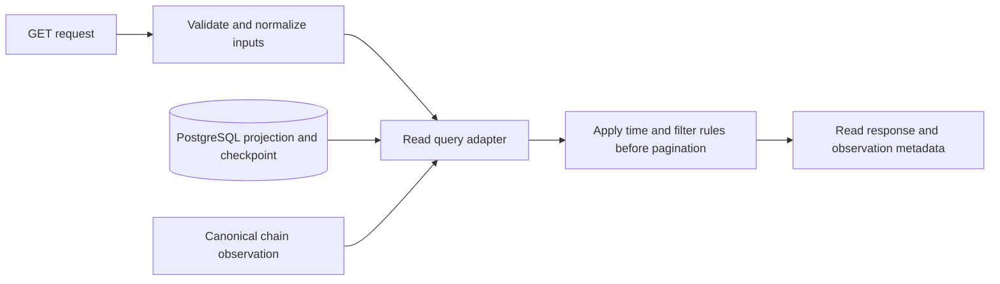

# Read API: reading guide and scope

Status: the S3 HTTP specification and examples are drafted/reviewed; handlers remain next. Contracts and the Ponder indexer are implemented. The challenge baseline uses direct PostgreSQL reads, no application cache and no AuthN/AuthZ middleware. The SDD owns acceptance; [OpenAPI and its reading guide](api/README.md) define the proposed exact HTTP schemas and implementation boundary.

The [supplied employer clarification](references.md#stakeholder-clarification-recorded-november-6) accepts internal-process consumers and expected network delay. Here, public API means the documented consumer-facing HTTP contract, not a decision to publish it on the internet. The local anonymous baseline is a challenge scope choice; a real internal deployment should define service identity and access policy. No quantified freshness SLA or authentication mechanism was mandated.

## What to read

| Document | Purpose |
| --- | --- |
| [Canonical SDD](sdd/escrow.md) | AC9-AC10 and the API boundary: routes, filters, time-derived state, errors and consistency. Start here for required behavior. |
| [Worked API example](design-review.md) | Record/observation envelope and an explanation of recorded versus effective state. Historical proposals are superseded by the current SDD; its polling and optional time-filter notes are not new requirements. |
| [PostgreSQL models](postgres-models.md) | Read the selected Ponder model and integrated application schema. The later polling DDL section is explicitly archived. |
| [Indexer runtime](indexer-runtime.md) | Current snapshot/canonical guard, observation metadata, startup readiness and replay behavior that S3 should reuse. |
| [Progress](progress.md) | What is implemented and the remaining S3-S5 gates. OpenAPI is tracked in #11; Swagger UI is optional polish after the candidate's clarification. |

## Planned public contract

| Operation | Purpose |
| --- | --- |
| GET /escrows/{id} | Detail for one escrow; malformed input is 400, absent ID is 404. |
| GET /escrows | Sender/beneficiary/effective-status filters before bounded limit/offset pagination, newest ID first. |
| GET /health | Honest RPC/DB/indexer observation, readiness, indexed/head progress, expected confirmation lag versus eligible backlog. |

IDs and amounts are lossless decimal strings. Preserve parties, token, emitted deadlines, recorded outcome and successful creation/resolution transaction references. Derive effectiveStatus/canCancel/canRecover from the same validated chain timestamp for the response. A recorded Pending escrow can become ExpiredRecoverable without another event; it becomes recorded Expired only after the recovery transaction. Time alone does not move tokens.

Rows and checkpoint must share a PostgreSQL snapshot. Observation metadata must describe those rows; canonical/readiness checks still apply. Unavailable RPC/DB, startup catch-up, an unverifiable checkpoint or unrecoverable mismatch means 503 rather than a successful stale view. Eligibility is an observation, not a guarantee a future transaction will succeed. Reverted wallet attempts and transaction submission are outside this API.

This is the intended S3 flow, not a claim that final HTTP handlers/filters are already implemented. Existing /observed endpoints are internal S2 diagnostics. Static OpenAPI documentation must remain independent of data readiness while the API process is running.

Token availability is separate from time eligibility: an ExpiredRecoverable record may still fail to pay because of an issuer freeze. The [token/freeze matrix](token-support.md) explains those limits without adding token-status fields or polling to S3.

## Future cache: record, do not implement

Tracking: [#13: Evaluate caching for the read API](https://github.com/dubzn/remitee-challenge/issues/13).

The candidate's goal is fewer repeated database reads. Evaluate a cache at the query/projection or response boundary only after measuring query cost and repetition. Connection pooling, Ponder RPC caching and an application data cache are different concerns. No cache backend, library, TTL or middleware is selected for this challenge.

The future design must keep these invariants:

- Cached rows and their checkpoint originate from one coherent snapshot. Never pair old rows with newer metadata. Scope keys include deployment/data identity, projection/schema version and checkpoint number/hash, plus normalized query filters and pagination.
- A full-response entry must also account for the observed head/hash/time used by derived fields, or those fields must be recomputed safely. Expiry can change without an escrow event. Effective-state filtering must remain before pagination; filtering an old cached page afterward is incorrect.
- Fresh readiness/canonical validation precedes a successful cached response. A hit cannot hide RPC loss, an unverifiable checkpoint, startup catch-up or a deep reorg. Same-height replacement, replay and scope/configuration changes invalidate entries; TTL alone is insufficient.
- Health successes/errors remain uncached. Documentation asset caching is separate. State the allowed freshness policy explicitly rather than introducing stale-success fallback accidentally.
- If AuthN/AuthZ is added later, authorize before lookup and partition entries by effective access scope/policy. Do not reuse restricted responses across callers/tenants.

A lightweight checkpoint/health lookup may still be necessary per request. The realistic first goal is avoiding heavier repeated detail/list queries, not promising zero database or RPC calls. Consider a shared cache only if measured multi-instance needs justify it. These are application-specific design constraints; HTTP cache behavior and authenticated-response reuse have their own rules. [HTTP caching reference](https://www.rfc-editor.org/rfc/rfc9111.html).

## Future AuthN/AuthZ: record, do not implement

Tracking: [#14: Evaluate read API authentication and authorization middleware](https://github.com/dubzn/remitee-challenge/issues/14).

Authentication identifies the caller; authorization decides which resources that caller may read. For this local read-only challenge, use anonymous access to the planned public query API and add neither runtime middleware nor a disabled placeholder. Record the extension for a future requirement instead.

With internal processes as the intended consumers, evaluate authentication of the calling service and authorization for its reads. Human user login and wallet identity are separate requirements. Internal placement and read-only methods do not replace access control for a restricted service. The supplied reply does not require implementing it in this challenge; #14 remains future work. [REST access-control guidance](https://cheatsheetseries.owasp.org/cheatsheets/REST_Security_Cheat_Sheet.html).

If access restrictions become necessary, resolve verified identity at the HTTP boundary and apply a separate read policy before query/cache access. Sender/beneficiary filters are search input, not proof of identity or ownership. Select a provider/credential scheme only after the actual public/tenant/party policy is agreed. A private API view does not make underlying public-chain facts private, and API permissions never grant on-chain payout authority. [REST access-control guidance](https://cheatsheetseries.owasp.org/cheatsheets/REST_Security_Cheat_Sheet.html).

Both cache and AuthN/AuthZ belong to the future-improvement backlog, outside S3/S4/S5 challenge completion. They introduce no delivery hours or implementation dependencies now.
