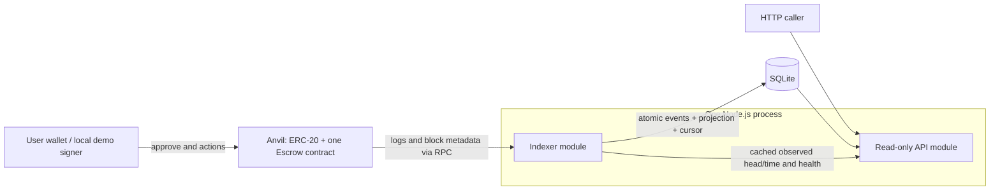

# ERC-20 escrow challenge

Status: proposed for discussion; planning only. Date: 2026-11-03.
Sources: [requirements and evaluation](../references.md). Delivery: [one-week plan](../delivery-plan.md).

## Problem and outcome

Deliver one local, reproducible system in which a sender locks ERC-20 tokens for a beneficiary and only the permitted party can resolve each escrow within the prescribed time windows. A read-only API reconstructs escrows from events and reports both recorded outcomes and time-dependent eligibility.

The candidate must be able to explain the implementation and its limitations in a 45-60 minute discussion.

## Scope

- One non-upgradeable contract managing multiple escrows and tokens.
- Four resolution paths: sender cancellation, beneficiary acceptance, beneficiary rejection, and sender recovery after expiry.
- Node.js/TypeScript API with a durable event indexer and SQLite projection.
- Three required GET endpoints; tests; one-command local environment; deterministic demo; README; AI prompt/output record.
- A few focused security/property tests and basic CI are the only planned optional additions, conditional on mandatory acceptance.

## Non-goals

Frontend, production/mainnet deployment, mandatory testnet deployment, transaction signing by the API, custody, proxies, owner recovery powers, cross-chain settlement, permit, fee-on-transfer support, webhooks, Kubernetes, cloud infrastructure, or a generalized indexing framework.

## Observable behavior

### State machine

| Current state | Action | Authorized caller | Required chain timestamp | New state | Recipient |
| --- | --- | --- | --- | --- | --- |
| None | Create | Sender | Any | Pending | Contract receives tokens |
| Pending | Cancel | Sender | `t < cancelDeadline` | CancelledBySender | Sender |
| Pending | Confirm | Beneficiary | `t < expiresAt` | Released | Beneficiary |
| Pending | Reject | Beneficiary | `t < expiresAt` | Rejected | Sender |
| Pending | Recover | Sender | `t >= expiresAt` | Expired | Sender |
| Any terminal state | Any resolution | Anyone | Any | Revert | No transfer |

Proposed constants: `cancelDeadline = createdAt + 2 hours`; `expiresAt = createdAt + 7 days`. At exactly 2 hours cancellation fails. At exactly 7 days confirmation/rejection fail and recovery succeeds. Passing time does not automatically send a transaction or refund tokens.

Within the first two hours both sender cancellation and beneficiary actions are possible. The first successful transaction in canonical chain order wins; there is no sender priority.

### Acceptance criteria

All criteria are currently **unverified**: there is no implementation. The evidence column defines future verification, not completed work.

| ID | Observable requirement | Required evidence |
| --- | --- | --- |
| AC1 | Valid creation locks the exact amount and records sender, beneficiary, token, deadlines, and unique ID. Zero amount, invalid beneficiary, invalid token address, and failed transfer revert without an escrow or event. Standard and no-return tokens work. | Contract happy-path, validation, allowance/balance failure, false-return, and no-return token tests. |
| AC2 | All four resolution paths use the caller and time rules above. Only Released pays the beneficiary. | Transition tests; `deadline - 1`, exact deadline, and `deadline + 1` tests for each relevant action. |
| AC3 | Unknown IDs (including getter reads), unauthorized callers, repeated resolution, and competing terminal actions revert with clear custom errors. No administrative escape path exists. | Access/error matrix and first-success-wins tests; interface review. |
| AC4 | Reentrancy cannot create an underfunded escrow or resolve one twice. Failed payouts leave the escrow pending and its funds/accounting unchanged. Escrows cannot spend another escrow's backing under the supported token assumptions. | Malicious callback token, failed outgoing transfer, multiple escrow/token, and conservation tests. |
| AC5 | Creation and every resolution emit sufficient events for reconstruction; the getter returns the same escrow facts. | Event payload assertions and projection reconstruction tests without per-escrow storage reads. |
| AC6 | Repeated events, reconnects, and overlapping fetched ranges do not duplicate escrows, overwrite later state, or corrupt the cursor. | Replay tests against the real database adapter. |
| AC7 | Restart resumes after the last completely committed range end, including ranges with no events. An interrupted range applies all its events and cursor or none. | Real-DB restart and crash/rollback tests with multiple ordered logs across blocks. |
| AC8 | Confirmation policy, chain identity, and checkpoint hash are observable; canonical mismatch halts indexing and marks the service unready until validated reset/replay. | Simulated mismatch, unchanged checkpoint/no partial writes, and explicit replay tests; README limitations. |
| AC9 | Detail/list endpoints expose parties, token, decimal-string amounts/IDs, event-provided deadlines, creation/resolution hashes, recorded status, effective status, cancellation eligibility, and expiry recovery eligibility. Status filtering happens before pagination. | Pure derivation tests for all states/boundaries, plus focused HTTP/DB tests for serialization, combined filters, invalid inputs, 404, and pagination. |
| AC10 | Health exposes RPC/database/indexer status, latest observed block/time, last indexed block, confirmation delay, lag, and recovery/error state. Unready service reports degraded health. | Health tests during catch-up, RPC failure, and mismatch recovery. |
| AC11 | One documented command starts local node, deploys the contract and test token, initializes the database, and starts the API. Demo uses separate escrows for all four outcomes, mines after time advancement, shows recoverable expiry before recovery, and verifies final API results. | Fresh environment run with no existing DB or deployment artifacts; deterministic time advancement. |
| AC12 | Repository includes contract and API tests, runnable instructions, design assumptions, HTTP examples, improvements, useful commits, and English AI outputs. | Final submission checklist and candidate explanation rehearsal. |

## Assumptions and proposed decisions

These are proposals, not additional requirements from Remitee.

| Decision | Proposal | Reason / limit |
| --- | --- | --- |
| Stack | Foundry/Anvil; Solidity 0.8.x; OpenZeppelin utilities; Node.js/TypeScript, viem, Fastify, SQLite. | Candidate confirmed Foundry + TypeScript familiarity. Exact compatible versions and SQLite adapter remain to be pinned. |
| Authority | No owner, pause, upgrade, or rescue method. | Nothing in the required lifecycle needs privileged fund movement. |
| Token policy | Standard balance-preserving ERC-20s and no-return tokens; reject deposits whose actual received amount differs from the requested amount. | Fee-on-transfer and rebasing behavior are outside the baseline. Arbitrary malicious tokens cannot be made economically safe by SafeERC20. See token spike. |
| Beneficiary validation | Reject zero, sender, and the escrow contract itself. | The first two are required; the third is a proposed extra guard against releasing funds back into the escrow with no withdrawal path. |
| Time source | Latest successfully observed canonical head timestamp, cached by the indexer, with source metadata in API/health. | Agrees with local EVM time travel. Host wall-clock time is not authoritative; never substitute it silently if RPC observation fails. |
| Read model | Preserve `onChainStatus`; derive `effectiveStatus`, `canCancel`, and `canRecover` using the event-provided deadlines. | Never recompute deadlines in the API. `ExpiredRecoverable` means recorded Pending with elapsed TTL. `Expired` means a recovery event exists. |
| Filter semantics | `status` filters `effectiveStatus`, including `ExpiredRecoverable`, in SQL before pagination; omitted filters include all. Sender/beneficiary filters combine with AND. | Expired pending escrows must be discoverable. All rows in one response use the same observed chain timestamp. |
| Pagination | Bounded `limit` and `offset`, deterministic ID ordering; amounts and IDs are decimal strings. | Small local dataset; no cross-request snapshot promise. Never coerce uint256 token amounts into JS numbers. |
| Finality | Configurable confirmation delay; local demo default 0 for immediate feedback. | Delayed indexing reduces exposure; no finite delay guarantees finality. The demo is not evidence of production finality. |
| Reorg recovery | Validate deployment anchor and checkpoint hashes at startup and each scan. Any mismatch halts indexing and marks unready; explicitly validate configuration, reset the disposable projection, and replay from the correct deployment. | One safe failure path; no automatic deletion on an identity mismatch, generalized fork rollback, or automatic recovery daemon. |

## Technical plan

### Architecture and trust boundaries

The chain owns outcomes and balances. SQLite is a rebuildable projection. The API has no private keys or write endpoints. Local demo/deployment signers are development-only and live outside the API boundary.

### Contract boundary

- Sequential IDs start at 1; distinguish missing IDs from Pending.
- Use safe ERC-20 calls and guard every external state-changing entry point against reentrancy, including creation.
- Validate caller/state/time before resolution. Set terminal state before external payout; payout failure reverts the whole transaction.
- Explicitly reject zero token address and addresses with no contract code; check received balance delta on creation. Do not depend on token symbol or decimals for correctness.
- Created event contains ID, sender, beneficiary, token, amount, cancellation deadline, and expiry; index ID, sender, and beneficiary. Terminal events contain ID and actor. Creation plus terminal event and log metadata reconstruct the full record and transaction hashes.
- Do not promise recovery if a token later blacklists the escrow, pauses transfers, rebases, or lies about its balance. Clearly state those asset-level limits.
- Conservation tests distinguish escrow liabilities from unsolicited direct token transfers: balance is at least pending liabilities under supported assumptions; equality only applies when the test excludes donations.

### Event processing boundary

One ordered HTTP polling worker observes the head and scans bounded block ranges from the deployment block through eligible head `latest - confirmationDelay`. This polling subscription to contract logs provides both live observation and catch-up; no second watcher, websocket path, or concurrent writer is needed. Poll even when the head is unchanged so RPC health is observed independently of block production.

Freeze each range end before fetching logs. Validate the previous checkpoint and range-end hash, fetch logs scoped to chain/contract, and sort by block number, transaction index, then log index. Recheck canonical range-end identity before committing deduplicated events, escrow updates, and the end-block checkpoint/hash in one SQLite transaction. Commit empty ranges too. Only newly inserted events affect the projection. Unknown/out-of-order transitions are errors, not fabricated escrows. Restart retries the last uncommitted range.

Use three small data groups: event journal (including tx/block hashes and log position), escrow projection, and indexer metadata/cursor. Event identity includes chain, contract, transaction hash, and log index. Chain/deployment identity includes a deployment anchor; chain ID alone is insufficient for local resets.

Any identity/hash mismatch triggers the single safe halt policy above. Suppress escrow reads while halted or rebuilding so partial or orphaned projections are not presented as current. Reset/replay is an explicit local operation against a validated deployment, not an automatic wipe using stale metadata. Confirmation delay, replay cost, RPC range limits, and residual race/deep-reorg exposure belong in the README.

### API boundary

`GET /escrows/:id`, `GET /escrows?sender=&beneficiary=&status=&limit=&offset=`, and `GET /health` are the only required endpoints. Validate query inputs; return 400 for malformed requests and 404 for absent escrows.

Transaction hashes cover successful escrow state changes: one creation and, if resolved, one resolution. Approval transactions and reverted wallet attempts are not reconstructable from escrow state-change logs and are outside this read model. Timestamps use Unix seconds consistently.

Compute derived fields at read time; no scheduled expiration updates and no synthetic chain events. `canCancel` and `canRecover` describe role/time eligibility for a recorded pending escrow at the reported observation, not a guarantee that a new transaction will succeed. Confirmation lag, concurrent resolutions, and token restrictions remain possible.

If there is no usable chain-time observation or the indexer is halted/rebuilding, return 503 for escrow reads. An observed failed RPC poll makes the observation unavailable until polling succeeds again. An unchanged old head timestamp alone does not imply an outage on idle Anvil. Keep 503 on RPC failure for the baseline; serving stale records with nullable eligibility is a deferred alternative. Report health and last-known metadata for diagnosis.

## Tasks

| Slice | Scope | Completion condition |
| --- | --- | --- |
| S0 | Discuss architecture and desk-reviewed spike decisions. | Candidate can explain the state machine, token assumption, replay strategy, and derived state; SDD updated without an additional open-ended research round. |
| S1 | Contract and its transition/security tests. | AC1-AC5 pass with actual token balances and boundary assertions. |
| S2 | Durable indexer, schema, and recovery tests. | AC6-AC8 pass using the intended DB adapter and local chain fixtures. |
| S3 | API and time/filter/health tests. | AC9-AC10 pass, including expiry without a recovery transaction. |
| S4 | One-command startup and complete demo. | AC11 passes from a clean local state; API and contract agree. |
| S5 | Documentation, review, explanation, and submission preparation. | AC12 and every mandatory criterion have recorded evidence. |

No data migration or rollout is needed now because the repository is empty. Future local schema changes may rebuild disposable projections from the pinned deployment. Deployment failure/reset must not reuse an unrelated database silently.

## Verification

There are no executed contract/API tests or verified application behaviors yet. Completed planning validation consists of source review, technical reference checks, and a separate Claude Opus/high architecture review. Its first invocation failed on expired OAuth; the retry succeeded. See [consultation status](../outputs/claude/README.md) and [Codex disposition](../outputs/codex/2026-11-03-review-disposition.md). Record implementation evidence beside each acceptance criterion once authorized.

Use actual SQLite transactions for idempotency/restart tests, explicit EVM timestamps for contract boundaries, and a clean end-to-end run for reproducibility. Before submission, review the complete diff, check that AI output claims match the implementation, and rehearse the known limitations.
