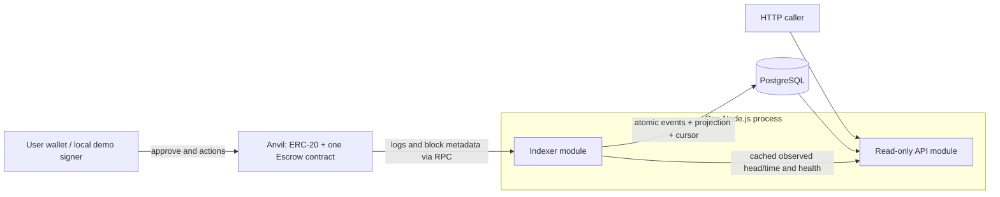

# ERC-20 escrow challenge

Status: proposed business behavior; infrastructure slice completed with local and CI evidence. Created: 2026-11-03. Updated: 2026-11-04.
Sources: [requirements and evaluation](../references.md). Delivery: [one-week plan](../delivery-plan.md).
Candidate feedback: [explanations and response example](../design-review.md). PostgreSQL is candidate-selected. Infrastructure/CI implementation is authorized; escrow/API/indexer implementation remains a later slice.
Current contract step: the candidate approved committing the [core interface/storage](../contract-design.md) and starting its implementation on 2026-11-05. Pause/upgrade decisions remain deferred and are not selected by this approval.
Latest discussion: [confirmation waiting, one writer, and pause trade-offs](../safety-review.md). AC6 observation-only scope and simple token semantics are accepted; emergency pause remains an open authority decision.
Visual walkthrough: [contract flow diagrams](../contract-flows.md). Every payout requires a new authorized resolution transaction; time alone does not execute or transfer tokens.
Next block: [infrastructure-first setup, CI and ownership](../infrastructure-plan.md), before business contract implementation. Unit contract tests later run without requiring Docker.

## Problem and outcome

Deliver one local, reproducible system in which a sender locks ERC-20 tokens for a beneficiary and only the permitted party can resolve each escrow within the prescribed time windows. A read-only API reconstructs escrows from events and reports both recorded outcomes and time-dependent eligibility.

The candidate must be able to explain the implementation and its limitations in a 45-60 minute discussion.

## Scope

- One deployment managing multiple escrow IDs and tokens; no contract deployment per operation. Direct non-upgradeable deployment is the earlier baseline proposal, with the pause/upgrade choice now explicitly deferred by the candidate until after core interface review.
- Four resolution paths: sender cancellation, beneficiary acceptance, beneficiary rejection, and sender recovery after expiry.
- Node.js/TypeScript API with a durable event indexer and PostgreSQL projection.
- Three required GET endpoints; tests; one-command local environment; deterministic demo; README; AI prompt/output record.
- Basic CI is planned baseline and starts with infrastructure checks. Focused adversarial/access/time tests are mandatory; an extended property suite and creation-time filtering are optional after required behavior is stable.

## Non-goals

Frontend, production/mainnet deployment, mandatory testnet deployment, transaction signing by the API, custody, owner recovery powers, cross-chain settlement, permit, fee-on-transfer support, token allowlist, arbitration/disputes, partial payouts, dashboard, failed-transaction observer, separate queue broker, webhooks, Kubernetes, cloud infrastructure, or a generalized indexing framework. Pause/proxy/upgrade authority is a deferred discussion, not selected implementation scope; any selection must revisit authority, initialization, layout and delivery cost.

## Observable behavior

### State machine

| Current state | Action | Authorized caller | Required chain timestamp | New state | Recipient |
| --- | --- | --- | --- | --- | --- |
| None | Create | Sender | Any | Pending | Contract receives tokens |
| Pending | Cancel | Sender | `t < cancelDeadline` | CancelledBySender | Sender |
| Pending | Confirm | Beneficiary | `t < expiresAt` | Released | Beneficiary |
| Pending | Reject | Beneficiary | `t < expiresAt` | Rejected | Sender |
| Pending | Recover | Sender | `t >= expiresAt` | Expired | Sender |
| Any terminal state | Any resolution | Anyone | Any | Revert | No transfer |

Proposed constants: `cancelDeadline = createdAt + 2 hours`; `expiresAt = createdAt + 7 days`. At exactly 2 hours cancellation fails. At exactly 7 days confirmation/rejection fail and recovery succeeds. Passing time does not automatically send a transaction or refund tokens.

Within the first two hours both sender cancellation and beneficiary actions are possible. The first successful transaction in canonical chain order wins; there is no sender priority.

### Acceptance criteria

AC1-AC5 have [local contract evidence](../outputs/codex/2026-11-05-contract-implementation.md); C10 remote CI remains pending until observed. AC6-AC12 remain unverified for the indexer/API/full submission. Foundation evidence remains [separate](../local-development.md).

| ID | Observable requirement | Required evidence |
| --- | --- | --- |
| AC1 | Valid creation locks the exact amount and records sender, beneficiary, token, deadlines, and unique ID. Zero amount, invalid beneficiary, invalid token address, and failed transfer revert without an escrow or event. Standard and no-return tokens work. | Contract happy-path, validation, allowance/balance failure, false-return, and no-return token tests. |
| AC2 | All four resolution paths use the caller and time rules above. Only Released pays the beneficiary. | Transition tests; `deadline - 1`, exact deadline, and `deadline + 1` tests for each relevant action. |
| AC3 | Unknown IDs (including getter reads), unauthorized callers, repeated resolution, and competing terminal actions revert with clear custom errors. No administrative escape path exists. | Access/error matrix and first-success-wins tests; interface review. |
| AC4 | Reentrancy cannot create an underfunded escrow or resolve one twice. Failed payouts leave the escrow pending and its funds/accounting unchanged. Escrows cannot spend another escrow's backing under the supported token assumptions. | Map review/tests to OWASP SC05:2025: malicious callbacks during creation and payout, cross-action reentry, failed transfers, multiple escrows/tokens, and backing invariants. This is not an audit claim. |
| AC5 | Creation and every resolution emit sufficient events for reconstruction; getter returns the same facts. Required names: EscrowCreated, EscrowCancelled, EscrowReleased, EscrowRejected, EscrowExpired. | Event/field assertions and reconstruction tests without per-escrow storage reads; freeze event signatures before indexer work. |
| AC6 | Observation/traceability only: repeated events, reconnects, and overlapping ranges cannot duplicate escrows, regress state, or corrupt the cursor. A second indexer cannot become a concurrent writer. No wallet transaction execution or resubmission is performed. | Actual PostgreSQL unique-event, replay, second-writer exclusion, stale-cursor rejection, and ordered-application tests. |
| AC7 | Restart resumes after the last completely committed range end, including ranges with no events. An interrupted range applies all its events and cursor or none. | Real-DB restart and crash/rollback tests with multiple ordered logs across blocks. |
| AC8 | Confirmation-delay policy, chain identity and checkpoint hash are observable. Events stay outside the projection until eligible and committed; a verified post-admission mismatch halts indexing until validated replay. | Depth N-1/N/N+1, orphan-before-admission, mismatch-after-admission, unchanged checkpoint/no partial writes, and explicit replay tests; README limitations. |
| AC9 | Detail/list expose parties, token, decimal-string amounts/IDs, creation time/deadlines, transaction hashes, recorded/effective status and eligibility. Required address/state filters run before newest-first pagination; rows/metadata share a DB snapshot. | Pure derivation plus PostgreSQL/HTTP tests for required filters, snapshots, serialization, invalid inputs, 404 and pagination. Half-open creation-time filters are optional; their tests are required only if selected. |
| AC10 | Health exposes RPC/DB/indexer status, observed head/time, last indexed block, delay, head lag, eligible-work backlog and recovery/error state. Expected confirmation lag is distinguished from unprocessed eligible work. | Health tests during catch-up, RPC failure, waiting for eligibility, and mismatch recovery. |
| AC11 | One command starts node, deployment, database and API. Demo uses separate escrows for all four outcomes, mines after time changes and enough extra blocks for the chosen delay, shows recoverable expiry before recovery, then verifies admitted API results. | Clean run; deterministic mining/time advancement; no wait that assumes idle Anvil will produce confirmations automatically. |
| AC12 | Repository includes contract and API tests, runnable instructions, design assumptions, HTTP examples, improvements, useful commits, and English AI outputs. | Final submission checklist and candidate explanation rehearsal. |

### Contract slice completion checklist

Nov 5: candidate approved the [core interface/storage](../contract-design.md) and implementation. This does not freeze a proxy layout or approve administration. These checks refine AC1-AC5 without adding another product scope; all remain unverified until implementation evidence is recorded.

- [x] **C1 - Funded creation (AC1):** exact deposit, correct immutable-per-escrow facts and deadlines, first ID 1, unique IDs; failed creation consumes no ID, record or successful escrow event.
- [x] **C2 - Validation and existence (AC1, AC3):** zero amount, required beneficiary exclusions, proposed self-beneficiary/token-code checks, insufficient allowance/balance; unknown ID 0/future IDs revert in getter/actions instead of returning a default Pending record. Each escrow custom error has a focused test of its exact selector/arguments; selected library errors use controlled fixtures.
- [x] **C3 - Resolution matrix (AC2, AC3):** all four paths, fixed recipients and actual token deltas; beneficiary cannot cancel/recover, sender cannot confirm/reject, unrelated callers and an unrelated deployer have no special rights. First successful competing action wins; repeated/alternative resolutions of every terminal state fail without changing funds.
- [x] **C4 - Exact time (AC2):** deadline -1/exact/+1 for cancellation at 2h and confirm/reject/recover at 7d; early acceptance works; elapsed TTL alone leaves storage/funds unchanged until sender recovery.
- [x] **C5 - Token behavior and rollback (AC1, AC4):** standard/no-return tokens, false/reverting deposit and payout calls, received-amount mismatch; failed payouts preserve Pending and backing without a successful resolution event.
- [x] **C6 - Reentrancy (AC4):** a malicious token attempts each of the five mutating entries from funding and payout callbacks; assert the inner selected guard error, not just an outer failure for some unrelated reason. Include a second-ID/token scenario; no full Cartesian test matrix or provisional unfunded record is needed.
- [x] **C7 - Escrow isolation (AC4):** fixed representative scenarios with several IDs/tokens, mixed terminal outcomes and donations check that supported-token balances cover Pending liabilities. A property/fuzz handler remains optional; production code has no unbounded summation feature.
- [x] **C8 - Getter and event reconstruction (AC5):** exact event names/types/indexed fields, one escrow event per successful transition, getter/event agreement and complete reconstruction without escrow storage reads. Revert/log consequences are covered with C1/C5, not a separate suite.
- [x] **C9 - Representation (AC1, AC5):** uint256 IDs/amounts retained; if uint64 timestamps are adopted, checked narrowing and a rejected out-of-range deadline are tested. Freeze the actual ABI/event signatures before indexer work; storage inspection is informational unless a proxy is selected later, with no gas benchmark required.
- [ ] **C10 - Integration and review (AC1-AC5, AC12):** real Foundry build/tests and relevant formatting checks pass locally and in CI; dependency versions, actual evidence and independent-review disposition are recorded. Inspect the compiled ABI: this core has exactly the five mutating actions, with no administrative escape path. A later authority feature must deliberately revise that check. No empty suite or AI review counts as execution proof.

## Assumptions and proposed decisions

These are proposals, not additional requirements from Remitee.

| Decision | Proposal | Reason / limit |
| --- | --- | --- |
| Stack | Foundry/Anvil; Solidity 0.8.x; OpenZeppelin utilities; Node.js/TypeScript, viem, Fastify, PostgreSQL with node-postgres. | Candidate selected PostgreSQL and confirmed Foundry + TypeScript familiarity. Pin compatible versions and include real PostgreSQL setup/migrations/tests. |
| Reuse | Prefer compatible maintained primitives or an exact-fit escrow over unnecessary custom mechanisms. Current recommendation is a minimal domain contract on SafeERC20/ReentrancyGuard. | Reviewed OpenZeppelin Escrow/VestingWallet are not drop-in matches; a wrapper still needs actor/time/token correctness and adversarial tests. See design review. |
| Authority, proposed baseline | Recommend no owner, pause, upgrade, or rescue method; API independently read-only. Pause/gateway remains under discussion. | The challenge forbids privileged fund movement, not the existence of an owner or a pause mechanism. No-pause is our design proposal; interference with actor/time availability needs explicit assessment. |
| Token policy, candidate-confirmed | Simple balance-preserving ERC-20 behavior plus mandatory no-return compatibility; reject deposits with a received-amount mismatch. | Per-escrow token choice remains; no fee/rebase/allowlist extension. Demo may use a simple mock, but required no-return tests remain. |
| Beneficiary validation | Reject zero, sender, and the escrow contract itself. | The first two are required; the third is a proposed extra guard against releasing funds back into the escrow with no withdrawal path. |
| Time source | Latest successfully observed canonical head timestamp, cached by the indexer, with source metadata in API/health. | Agrees with local EVM time travel. Host wall-clock time is not authoritative; never substitute it silently if RPC observation fails. |
| Read model | Preserve `onChainStatus`; derive `effectiveStatus`, `canCancel`, and `canRecover` using the event-provided deadlines. | Never recompute deadlines in the API. `ExpiredRecoverable` means recorded Pending with elapsed TTL. `Expired` means a recovery event exists. |
| Filter semantics | `status` filters `effectiveStatus`, including `ExpiredRecoverable`, in SQL before pagination; omitted filters include all. Sender/beneficiary filters combine with AND. | Expired pending escrows must be discoverable. All rows in one response use the same observed chain timestamp. |
| Pagination and optional time filters | Bounded `limit`/`offset`, newest first by decreasing ID. Defer `createdFrom` inclusive / `createdTo` exclusive until mandatory slices are stable. | `limit=N` gives latest N matches. Required filters run before pagination; optional time filters use the same rule if added. No cross-request snapshot promise. |
| Confirmation policy, proposed | Configurable depth; propose local demo delay 2 additional blocks after inclusion, with 0 an explicit fast-test mode. Project only eligible canonical events. | `eligibleHead = head - delay`; not a wallet/library confirmation-count convention or consensus finality. Mine extra blocks in the local demo. No production N is selected. |
| Reorg recovery | Validate deployment anchor and checkpoint hashes at startup and each scan. Any mismatch halts indexing and marks unready; explicitly validate configuration, reset the disposable projection, and replay from the correct deployment. | One safe failure path; no automatic deletion on an identity mismatch, generalized fork rollback, or automatic recovery daemon. |

## Technical plan

### Architecture and trust boundaries

The chain owns outcomes and balances. PostgreSQL is a rebuildable projection. The API has no private keys or write endpoints. Local demo/deployment signers are development-only and live outside the API boundary.

### Contract boundary

- Sequential IDs start at 1; distinguish missing IDs from Pending.
- Use safe ERC-20 calls and guard every external state-changing entry point against reentrancy, including creation.
- Creation validates, reads the prior token balance, transfers under the guard, verifies the received delta, then writes the fully funded escrow and emits its event. Do not expose a provisional unfunded record during callbacks; do not force payout-style ordering onto this deposit check.
- Validate caller/state/time before resolution. Set terminal state before external payout; payout failure reverts the whole transaction.
- Explicitly reject zero token address and addresses with no contract code; check received balance delta on creation. Do not depend on token symbol or decimals for correctness.
- Created event contains all mandatory fields plus `createdAt = block.timestamp`; index ID, sender, and beneficiary. This supplies creation-time filtering without guessing timestamps or changing the API's deadline arithmetic. Terminal events contain ID and actor. Events and log metadata reconstruct the record and transaction hashes.
- Do not promise recovery if a token later blacklists the escrow, pauses transfers, rebases, or lies about its balance. Clearly state those asset-level limits.
- Conservation tests distinguish escrow liabilities from unsolicited direct token transfers: balance is at least pending liabilities under supported assumptions; equality only applies when the test excludes donations.

### Event processing boundary

One ordered HTTP polling worker observes the head and scans bounded block ranges from the deployment block through eligible head `latest - confirmationDelay`. This polling subscription to contract logs provides both live observation and catch-up; no second watcher, websocket path, or concurrent writer is needed. Poll even when the head is unchanged so RPC health is observed independently of block production.

One writer is a workload-based starting assumption, not a benchmark derived from Ethereum's block cadence. Observe range duration, event volume, RPC/DB timings and `max(0, eligibleHead - indexedThrough)` backlog. Bounded concurrent RPC prefetch is a future response to measured fetch bottlenecks; preserve one ordered commit coordinator and never skip a gap in the checkpoint.

Enforce one writer per deployment using a PostgreSQL session advisory lock on the worker's dedicated connection. A second instance stays unready instead of writing. On connection loss, stop and reacquire/validate before resuming. Range commits also compare the prior cursor number/hash with the expected predecessor; any mismatch rolls back the entire transaction. Deduplication alone cannot prevent stale cursor writes.

Normal indexing never decreases the checkpoint. A wholly processed old range is a no-op; a new range with a stale expected predecessor is rejected and rolled back. An overlap that extends past the current checkpoint may commit its new tail only with the current expected predecessor; duplicate prefix events do not mutate state. Only validated reset/replay may rewind, under the same writer lock with reads unready.

Freeze each range end before fetching logs. Validate the previous checkpoint and range-end hash, fetch logs scoped to chain/contract, and sort by block number, transaction index, then log index. Recheck canonical range-end identity before committing deduplicated events, escrow updates, and the end-block checkpoint/hash in one PostgreSQL transaction. Commit empty ranges too. Only newly inserted events affect the projection. Unknown/out-of-order transitions are errors, not fabricated escrows. Restart retries the last uncommitted range.

Verify each log's blockHash against a fetched canonical header for its block number, reusing one header lookup per event-bearing block, as well as the range-end recheck. Inconsistent/missing data cannot be committed. This detects ordinary fork/stale-response inconsistencies; the RPC provider remains trusted and this is not a cryptographic proof of its full response.

Use three small data groups: event journal, escrow projection, and indexer metadata/cursor. Scope unique event identity to chain/contract/deployment, transaction hash, and log index. Insert with conflict-ignore/returning keys and mutate only newly inserted events, in the worker's explicitly sorted order; never rely on RETURNING row order. Keep all transaction statements on the same node-postgres client. Store uint256 amounts/IDs losslessly, proposed `NUMERIC(78,0)`, normalize address case, and explicitly serialize numbers/strings. No new escrow row may reset an existing terminal projection.

The journal traces observed successful transitions. Persist checkpoint and last-error metadata and emit structured range/retry logs; do not label this a complete durable history of wallet or worker attempts. No wallet signing, transaction submission/retry queue, or separate broker is part of this worker.

Only admitted events enter the baseline journal/projection. Before admission, head/delay/checkpoint metadata and a client's known receipt can explain waiting; no second provisional transaction store is promised. Re-query/validate canonical logs at eligibility. A deeper reorg after admission still requires hash verification/recovery. Delaying projection does not delay on-chain execution.

Any identity/hash mismatch triggers the single safe halt policy above. Suppress escrow reads while halted or rebuilding so partial or orphaned projections are not presented as current. Reset/replay is an explicit local operation against a validated deployment, not an automatic wipe using stale metadata. Confirmation delay, replay cost, RPC range limits, and residual race/deep-reorg exposure belong in the README.

RPC timeouts, unavailable checkpoint blocks, or a head behind the stored cursor make verification unavailable and the service unready; they do not alone prove a reorg or justify deletion. Confirm the canonical hash/identity or diagnose a reset/stale provider before explicit recovery.

### API boundary

`GET /escrows/:id`, `GET /escrows?sender=&beneficiary=&status=&limit=&offset=` and `GET /health` are baseline endpoints. `createdFrom`/`createdTo` remain a deferred optional extension, not required acceptance. Validate inputs; if time bounds are added, validate contradictory bounds too. Return 400 for malformed requests and 404 for absent escrows. Lists contain escrow records, not raw events; see the proposed envelope in the design review.

Read rows and indexed cursor/hash from one PostgreSQL statement or one `REPEATABLE READ READ ONLY` transaction using the same connection. Use one captured observed RPC head/time for derivation across the response and ensure it is compatible with the reported checkpoint. Default READ COMMITTED across separate statements does not provide this guarantee. Expose observed head/hash/time, indexed block/hash, confirmation delay, and lag; do not claim synchronous freshness with the chain head.

Transaction hashes cover successful escrow state changes: one creation and, if resolved, one resolution. Approval transactions and reverted wallet attempts are not reconstructable from escrow state-change logs and are outside this read model. Timestamps use Unix seconds consistently.

Mined reverts can still be observed through transaction receipts when their hashes are known. Wallet rejection/simulation failure before broadcast has no on-chain receipt. A failed-attempt observer and dashboard remain future research, as distinct from the event projection. Never retry a create transaction automatically: a new nonce can create and fund a second escrow.

Compute derived fields at read time; no scheduled expiration updates and no synthetic chain events. `canCancel` and `canRecover` describe role/time eligibility for a recorded pending escrow at the reported observation, not a guarantee that a new transaction will succeed. Confirmation lag, concurrent resolutions, and token restrictions remain possible.

If there is no usable chain-time observation or the indexer is halted/rebuilding, return 503 for escrow reads. An observed failed RPC poll makes the observation unavailable until polling succeeds again. An unchanged old head timestamp alone does not imply an outage on idle Anvil. Keep 503 on RPC failure for the baseline; serving stale records with nullable eligibility is a deferred alternative. Report health and last-known metadata for diagnosis.

## Tasks

| Slice | Scope | Completion condition |
| --- | --- | --- |
| S0 | Discuss architecture and desk-reviewed spike decisions. | Candidate can explain the state machine, token assumption, replay strategy, and derived state; SDD updated without an additional open-ended research round. |
| I0 | Scaffold, Docker foundation and initial CI before business behavior. | Actual RPC/DB/rollback/mining/negative-case evidence; green CI on the pushed SHA. No empty suite presented as contract coverage. |
| S1 | Contract and its transition/security tests. | AC1-AC5 pass with actual token balances and boundary assertions. |
| S2 | Durable indexer, schema, and recovery tests. | AC6-AC8 pass using the intended DB adapter and local chain fixtures. |
| S3 | API and time/filter/health tests. | AC9-AC10 pass, including expiry without a recovery transaction. |
| S4 | One-command startup and complete demo. | AC11 passes from a clean local state; API and contract agree. |
| S5 | Documentation, review, explanation, and submission preparation. | AC12 and every mandatory criterion have recorded evidence. |

No data migration or rollout is needed yet: the contract is implemented, but there is no deployed application or domain database. Future local schema changes may rebuild disposable projections from the pinned deployment. Deployment failure/reset must not reuse an unrelated database silently.

## Verification

The implemented core has 62 passing contract tests and compiled ABI/layout evidence; see [implementation verification](../outputs/codex/2026-11-05-contract-implementation.md). API/indexer behavior remains unverified. Foundation verification is in [local development](../local-development.md). Planning validation includes source/reference checks, separate Claude Opus/high architecture reviews and the Nov 4 Opus/xhigh pre-commit review. The first architecture invocation failed on expired OAuth; the retry and later reviews succeeded. See [consultation status](../outputs/claude/README.md) and [pre-commit disposition](../outputs/codex/2026-11-04-preflight-decisions.md). Record implementation evidence beside each acceptance criterion as its slice is completed.

Use actual PostgreSQL transactions and a separate database per parallel test worker; schema separation alone does not isolate advisory locks. Use a private Anvil per integration worker or run time-travel suites serially. Foundry unit tests use their in-process EVM independently of Docker. Compose provisions local Anvil/PostgreSQL and startup migrations; preserve/validate chain identity or reset both datasets explicitly. Before submission, review the diff, check AI claims against implementation and rehearse limitations.
