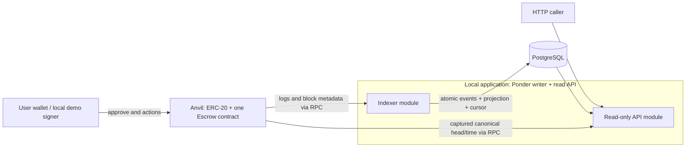

# ERC-20 escrow challenge

Status: infrastructure/contracts/indexer and S3 API have local and observed published CI evidence. November 8 contract reference generation has separate local checks; S4/S5 remain open. Created: 2026-11-03. Updated: 2026-11-08.
Sources: [requirements and evaluation](../references.md). Delivery: [one-week plan](../delivery-plan.md).
Candidate feedback: [explanations and response example](../design-review.md). PostgreSQL is candidate-selected. The read API now has [local implementation/review evidence](../outputs/codex/2026-11-07-read-api-implementation.md); full startup/demo remains S4. Earlier [indexer evidence](../outputs/codex/2026-11-06-indexer-integration.md) is retained.
Contract milestone: the approved [core interface/storage](../contract-design.md) is implemented and C1-C10 are complete. On Nov 6 the candidate requested closing the Nov 5 block and tracking alternatives as future improvements; see [closeout](../outputs/codex/2026-11-06-contract-closeout.md).
Latest discussion: [confirmation waiting, one writer, and pause trade-offs](../safety-review.md). AC6 observation-only scope and simple token semantics are accepted; emergency pause is now a future evaluation in [#8](https://github.com/dubzn/remitee-challenge/issues/8), outside this challenge deliverable.
Visual walkthrough: [contract flow diagrams](../contract-flows.md). Every payout requires a new authorized resolution transaction; time alone does not execute or transfer tokens.
Completed foundation/core: [implementation blocks, CI and ownership](../infrastructure-plan.md). Unit contract tests run with Foundry without requiring Docker; the reproducible wrapper also runs them in the pinned image.

## Problem and outcome

Deliver one local, reproducible system in which a sender locks ERC-20 tokens for a beneficiary and only the permitted party can resolve each escrow within the prescribed time windows. A read-only API reconstructs escrows from events and reports both recorded outcomes and time-dependent eligibility.

The candidate must be able to explain the implementation and its limitations in a 45-60 minute discussion.

## Scope

- One deployment managing multiple escrow IDs and tokens; no contract deployment per operation. The challenge uses the implemented direct, non-upgradeable contract without pause. Alternative pause/upgrade designs are future evaluations in [#8](https://github.com/dubzn/remitee-challenge/issues/8)/[#9](https://github.com/dubzn/remitee-challenge/issues/9).
- Four resolution paths: sender cancellation, beneficiary acceptance, beneficiary rejection, and sender recovery after expiry.
- Node.js/TypeScript API with a durable event indexer and PostgreSQL projection.
- Three required GET endpoints; tests; one-command local environment; deterministic demo; README; AI prompt/output record.
- Basic CI is planned baseline and starts with infrastructure checks. Focused adversarial/access/time tests are mandatory; an extended property suite and creation-time filtering are optional after required behavior is stable.

## Non-goals

Frontend, production/mainnet deployment, mandatory testnet deployment, transaction signing by the API, custody, owner recovery powers, cross-chain settlement, permit, fee-on-transfer support, token allowlist, arbitration/disputes, partial payouts, dashboard, failed-transaction observer, separate queue broker, webhooks, Kubernetes, cloud infrastructure, or a generalized indexing framework. Pause/proxy/upgrade authority is future improvement work in #8/#9, outside this deliverable and not a contract completion gate. Any later selection must revisit authority, initialization, layout and cost.

## Observable behavior

### State machine

| Current state | Action | Authorized caller | Required chain timestamp | New state | Recipient |
| --- | --- | --- | --- | --- | --- |
| None | Create | Sender | Any | Pending | Contract receives tokens |
| Pending | Cancel | Sender | `t < cancelDeadline` | CancelledBySender | Sender |
| Pending | Confirm | Beneficiary | `t < expiresAt` | Released | Beneficiary |
| Pending | Reject | Beneficiary | `t < expiresAt` | Rejected | Sender |
| Pending | Recover | Sender | `t >= expiresAt` | Expired | Sender |
| Any terminal state | Any resolution | Anyone | Any | Revert | No transfer |

Implemented constants: `cancelDeadline = createdAt + 2 hours`; `expiresAt = createdAt + 7 days`. At exactly 2 hours cancellation fails. At exactly 7 days confirmation/rejection fail and recovery succeeds. Passing time does not automatically send a transaction or refund tokens. Challenge page 1 also permits immutable parameters fixed at deployment; constants are our selected option. Per-escrow custom durations are a separate future proposal in [contract design](../contract-design.md#timing-configuration-current-policy-and-future-alternatives), not implemented or added to acceptance.

Within the first two hours both sender cancellation and beneficiary actions are possible. The first successful transaction in canonical chain order wins; there is no sender priority.

The [supplied stakeholder reply](../references.md#stakeholder-clarification-recorded-november-6) accepts an explained choice, and the candidate explicitly retains this interpretation. Benefit: the beneficiary can settle immediately without a forced two-hour wait. Trade-off: cancellation is available only while Pending, not guaranteed for the entire two hours. If confirmation succeeds first, release is terminal and later cancellation reverts; neither the API's admission delay nor an administrator provides a reversal path.

### Acceptance criteria

AC1-AC5/C1-C10 have [local and observed CI evidence](../outputs/codex/2026-11-05-contract-implementation.md). AC6-AC8 have [indexer evidence](../outputs/codex/2026-11-06-indexer-integration.md) and [observed CI](https://github.com/dubzn/remitee-challenge/actions/runs/42248952896). AC9-AC10 have [local PostgreSQL/HTTP acceptance and review](../outputs/codex/2026-11-07-read-api-implementation.md) and [published S3 CI on 80f1367](https://github.com/dubzn/remitee-challenge/actions/runs/42340576160), confirmed November 8. The November 8 NatSpec/documentation changes require separate verification; this run does not cover them. AC11/AC12 remain full-submission gates. Foundation evidence is [separate](../local-development.md).

| ID | Observable requirement | Required evidence |
| --- | --- | --- |
| AC1 | Valid creation locks the exact amount and records sender, beneficiary, token, deadlines, and unique ID. Zero amount, invalid beneficiary, invalid token address, and failed transfer revert without an escrow or event. Standard and no-return tokens work. | Contract happy-path, validation, allowance/balance failure, false-return, and no-return token tests. |
| AC2 | All four resolution paths use the caller and time rules above. Only Released pays the beneficiary. | Transition tests; `deadline - 1`, exact deadline, and `deadline + 1` tests for each relevant action. |
| AC3 | Unknown IDs (including getter reads), unauthorized callers, repeated resolution, and competing terminal actions revert with clear custom errors. No administrative escape path exists. | Access/error matrix and first-success-wins tests; interface review. |
| AC4 | Reentrancy cannot create an underfunded escrow or resolve one twice. Failed payouts leave the escrow pending and its funds/accounting unchanged. Escrows cannot spend another escrow's backing under the supported token assumptions. | Map review/tests to OWASP SC05:2025: malicious callbacks during creation and payout, cross-action reentry, failed transfers, multiple escrows/tokens, and backing invariants. This is not an audit claim. |
| AC5 | Creation and every resolution emit sufficient events for reconstruction; getter returns the same facts. Required names: EscrowCreated, EscrowCancelled, EscrowReleased, EscrowRejected, EscrowExpired. | Event/field assertions and reconstruction tests without per-escrow storage reads; freeze event signatures before indexer work. |
| AC6 | Observation/traceability only: repeated events, reconnects, and overlapping ranges cannot duplicate escrows, regress state outside verified canonical rollback, or corrupt the cursor. A second indexer cannot become a concurrent writer. No wallet transaction execution or resubmission is performed. | Actual PostgreSQL unique-event, replay, second-writer exclusion, stale-writer exclusion, and ordered-application tests. |
| AC7 | Restart resumes after the last completely committed range end, including ranges with no events. An interrupted range applies all its events and cursor or none. | Real-DB restart and crash/rollback tests with multiple ordered logs across blocks. |
| AC8 | Confirmation-delay policy, chain identity and checkpoint hash are observable. Events stay outside the projection until eligible and committed; canonical history can rollback/replay within a bounded recovery window; an unrecoverable mismatch blocks reads until validated replay. | Depth N-1/N/N+1, orphan-before-admission, within-window rollback, beyond-window read blocking, no partial writes, and explicit replay tests; README limitations. |
| AC9 | Detail/list expose parties, token, decimal-string amounts/IDs, creation time/deadlines, transaction hashes, recorded/effective status and eligibility. Required address/state filters run before newest-first pagination; rows/metadata share a DB snapshot. | Pure derivation plus PostgreSQL/HTTP tests for required filters, snapshots, serialization, invalid inputs, 404 and pagination. Half-open creation-time filters are optional; their tests are required only if selected. |
| AC10 | Health exposes RPC/DB/indexer status, observed head/time, last indexed block, delay, head lag, eligible-work backlog and recovery/error state. Expected confirmation lag is distinguished from unprocessed eligible work. | Health tests during catch-up, RPC failure, waiting for eligibility, and mismatch recovery. |
| AC11 | One command starts node, deployment, database and API. Demo uses separate escrows for all four outcomes, mines after time changes and enough extra blocks for the chosen delay, shows recoverable expiry before recovery, then verifies admitted API results. | Clean run; deterministic mining/time advancement; no wait that assumes idle Anvil will produce confirmations automatically. |
| AC12 | Repository includes contract and API tests, runnable instructions, design assumptions, HTTP examples, improvements, useful commits, and English AI outputs. | Final submission checklist and candidate explanation rehearsal. |

### Contract slice completion checklist

Nov 5: candidate approved the [core interface/storage](../contract-design.md) and implementation. This does not freeze a proxy layout or approve administration. These checks refine AC1-AC5 without adding another product scope; all ten are now backed by implementation, local execution and observed CI evidence.

- [x] **C1 - Funded creation (AC1):** exact deposit, correct immutable-per-escrow facts and deadlines, first ID 1, unique IDs; failed creation consumes no ID, record or successful escrow event.
- [x] **C2 - Validation and existence (AC1, AC3):** zero amount, required beneficiary exclusions, proposed self-beneficiary/token-code checks, insufficient allowance/balance; unknown ID 0/future IDs revert in getter/actions instead of returning a default Pending record. Each escrow custom error has a focused test of its exact selector/arguments; selected library errors use controlled fixtures.
- [x] **C3 - Resolution matrix (AC2, AC3):** all four paths, fixed recipients and actual token deltas; beneficiary cannot cancel/recover, sender cannot confirm/reject, unrelated callers and an unrelated deployer have no special rights. First successful competing action wins; repeated/alternative resolutions of every terminal state fail without changing funds.
- [x] **C4 - Exact time (AC2):** deadline -1/exact/+1 for cancellation at 2h and confirm/reject/recover at 7d; early acceptance works; elapsed TTL alone leaves storage/funds unchanged until sender recovery.
- [x] **C5 - Token behavior and rollback (AC1, AC4):** standard/no-return tokens, false/reverting deposit and payout calls, received-amount mismatch; failed payouts preserve Pending and backing without a successful resolution event.
- [x] **C6 - Reentrancy (AC4):** a malicious token attempts each of the five mutating entries from funding and payout callbacks; assert the inner selected guard error, not just an outer failure for some unrelated reason. Include a second-ID/token scenario; no full Cartesian test matrix or provisional unfunded record is needed.
- [x] **C7 - Escrow isolation (AC4):** fixed representative scenarios with several IDs/tokens, mixed terminal outcomes and donations check that supported-token balances cover Pending liabilities. A property/fuzz handler remains optional; production code has no unbounded summation feature.
- [x] **C8 - Getter and event reconstruction (AC5):** exact event names/types/indexed fields, one escrow event per successful transition, getter/event agreement and complete reconstruction without escrow storage reads. Revert/log consequences are covered with C1/C5, not a separate suite.
- [x] **C9 - Representation (AC1, AC5):** uint256 IDs/amounts retained; if uint64 timestamps are adopted, checked narrowing and a rejected out-of-range deadline are tested. Freeze the actual ABI/event signatures before indexer work; storage inspection is informational unless a proxy is selected later, with no gas benchmark required.
- [x] **C10 - Integration and review (AC1-AC5, AC12):** real Foundry build/tests and relevant formatting checks pass locally and in CI; dependency versions, actual evidence and independent-review disposition are recorded. Inspect the compiled ABI: this core has exactly the five mutating actions, with no administrative escape path. A later authority feature must deliberately revise that check. No empty suite or AI review counts as execution proof.

## Assumptions and proposed decisions

These are proposals, not additional requirements from Remitee.

| Decision | Proposal | Reason / limit |
| --- | --- | --- |
| Stack | Foundry/Anvil; Solidity 0.8.x; OpenZeppelin; Node.js/TypeScript, viem, PostgreSQL/node-postgres and Ponder. S3 selects native node:http for the consumer listener; existing Hono remains internal. | This supersedes the early unimplemented Fastify proposal. No new HTTP framework is needed for three GET routes. See the selected launcher boundary in the HTTP contract guide. |
| Reuse | Prefer compatible maintained primitives or an exact-fit escrow over unnecessary custom mechanisms. Current recommendation is a minimal domain contract on SafeERC20/ReentrancyGuard. | Reviewed OpenZeppelin Escrow/VestingWallet are not drop-in matches; a wrapper still needs actor/time/token correctness and adversarial tests. See design review. |
| Authority, challenge baseline | Current direct contract has no owner, pause, upgrade or rescue method; API independently read-only. #8/#9 evaluate future alternatives. | The challenge forbids privileged fund movement, not an owner or pause mechanism explicitly. The chosen scope preserves actor/time availability; future authority changes need separate assessment. |
| Token policy, candidate-confirmed | Simple balance-preserving ERC-20 behavior plus mandatory no-return compatibility; reject deposits with a received-amount mismatch. | Per-escrow token choice remains; no fee/rebase/allowlist extension. Demo may use a simple mock, but required no-return tests remain. |
| Beneficiary validation | Reject zero, sender, and the escrow contract itself. | The first two are required; the third is a proposed extra guard against releasing funds back into the escrow with no withdrawal path. |
| Time source | Canonical head timestamp captured per response by the read API and reused for that response's query/derivation. | No indexer head cache or host-clock fallback. Keep source metadata and canonical rechecks; an RPC failure makes that response unavailable. |
| Read model | Preserve `onChainStatus`; derive `effectiveStatus`, `canCancel`, and `canRecover` using the event-provided deadlines. | Never recompute deadlines in the API. `ExpiredRecoverable` means recorded Pending with elapsed TTL. `Expired` means a recovery event exists. |
| Filter semantics | `status` filters `effectiveStatus`, including `ExpiredRecoverable`, in SQL before pagination; omitted filters include all. Sender/beneficiary filters combine with AND. | Expired pending escrows must be discoverable. All rows in one response use the same observed chain timestamp. |
| Pagination and optional time filters | Bounded `limit`/`offset`, newest first by decreasing ID. Defer `createdFrom` inclusive / `createdTo` exclusive until mandatory slices are stable. | `limit=N` gives latest N matches. Required filters run before pagination; optional time filters use the same rule if added. No cross-request snapshot promise. |
| API consumer, stakeholder-clarified | Internal processes are an acceptable consumer. Local demo access remains anonymous; evaluate service AuthN/AuthZ separately in #14. | The reply does not mandate a provider, credential scheme or new implementation. Read-only access does not itself establish an access policy. |
| Confirmation policy, implemented | CONFIRMATION_DELAY selects integer 0..10000 additional blocks after inclusion; default 2, zero explicit no-extra-delay mode. Project only eligible canonical events. | `eligibleHead = max(0, head - delay)`; not a wallet/library confirmation-count convention or consensus finality. Policy changes require fresh data scope/replay. Expected network delay was accepted; no production N or latency SLA was selected. |
| Reorg recovery | Ponder rollback/replay inside an explicit positive timestamp window; canonical read guard for every response. Beyond-window or identity mismatch blocks reads until validated replay. | No automatic wipe on identity/RPC failure; the checkpoint may rewind only as part of verified framework rollback or explicit replay. |

## Technical plan

### Architecture and trust boundaries

The chain owns outcomes and balances. PostgreSQL is a rebuildable projection. The API has no private keys or write endpoints. Local demo/deployment signers are development-only and live outside the API boundary.

### Contract boundary

- Sequential IDs start at 1; distinguish missing IDs from Pending.
- Use safe ERC-20 calls and guard every external state-changing entry point against reentrancy, including creation.
- Creation validates, reads the prior token balance, transfers under the guard, verifies the received delta, then writes the fully funded escrow and emits its event. Do not expose a provisional unfunded record during callbacks; do not force payout-style ordering onto this deposit check.
- Validate caller/state/time before resolution. Set terminal state before external payout; payout failure reverts the whole transaction.
- Explicitly reject zero token address and addresses with no contract code; check received balance delta on creation. Do not depend on token symbol or decimals for correctness.
- Created event contains all mandatory fields plus `createdAt = block.timestamp`; index ID, sender, and beneficiary. This supplies creation-time filtering without guessing timestamps or changing the API's deadline arithmetic. Terminal events contain ID and actor. Events and log metadata reconstruct the record and transaction hashes.
- Do not promise recovery if a token later blacklists the escrow, pauses transfers, rebases, or lies about its balance. The [token compatibility and freeze matrix](../token-support.md) explains shared-address exposure, conditional exits and current test limits. Detected payout failure restores Pending; TTL does not override issuer controls or stop during a pause. No allowlist, token monitor or rescue extension is introduced.
- Conservation tests distinguish escrow liabilities from unsolicited direct token transfers: balance is at least pending liabilities under supported assumptions; equality only applies when the test excludes donations.

### Event processing boundary

**Ponder 0.18.5 is selected** after the [bounded runtime follow-up](../outputs/codex/2026-11-06-ponder-decision.md). The [worker/provider design](../indexer-design.md) and [selected database model](../postgres-models.md) are authoritative. The earlier polling cursor/advisory-lock protocol is archived, not a second layer on top of the framework. Production AC6-AC8 remain open.

Use one Ponder writer for the pinned deployment. Ponder owns log ordering, durable internal progress, transaction/restart semantics, writer exclusion and bounded rollback. Validate the descriptor (chain/genesis/contract/deployment number/hash) and keep local/testnet data separate. An unknown identity never repoints existing rows or triggers an automatic wipe.

A thin event adapter normalizes the five contract events. Engine-independent projection rules depend on a ProjectionStore port; only its Ponder adapter uses the current context.db. Do not write through another pg client or open an independent handler transaction. Journal and escrow changes participate in the framework's unit of work. Unknown/illegal terminal transitions fail instead of inventing rows.

Scope event identity to deployment plus transaction hash/log index. An existing identity must match block position/hash, name, escrow ID and normalized payload. Identical replay is a no-op; conflicting replay fails. Only new events change escrows. A terminal escrow cannot be reset by duplicate creation. Primary keys and single-writer exclusion enforce this alongside restart recovery. No distributed exactly-once or wallet transaction resubmission guarantee is claimed.

A public block handler upserts an application-owned checkpoint (number/hash/timestamp) on every eligible block, including empty ones. It uses the same context.db and never edits framework internals. It reports the projection's visible position, not a competing ingestion cursor. The experiment proved that a kill between journal and projection leaves neither committed and does not advance checkpoint through the interrupted block.

For local admission, expose the chain to the engine delayed by two additional blocks. This is not consensus finality. Keep a positive timestamp-based recovery window: use an explicit/configurable 180-second integration baseline; the 12-second fixture only accelerates deterministic tests. Admission depth counts blocks; the recovery window counts seconds. The two values are not interchangeable.

Inside the window, let Ponder rollback/replay canonical history automatically. Each response must be consistent with its reported canonical checkpoint; a canonical older prefix is allowed with visible progress/backlog. A verified mismatch beyond recovery, identity mismatch, missing checkpoint or unavailable RPC blocks public reads. Explicit validated replay against a fresh disposable data scope restores service; timeouts alone never justify deletion. This deliberately replaces the earlier halt-on-every-admitted-mismatch implementation choice, without changing the challenge's observable traceability requirement.

Read rows and checkpoint in one SQL snapshot, validate current deployment/canonical hash and recheck before response. Native framework /ready and /health are internal signals, not public application health. The proof uses supported prefixed routes; the final read API must expose the required paths with equivalent guards, and can use a separate read-only pg query adapter. RPC/SQL cannot form an atomic cross-system snapshot: retain the residual race and trust assumptions in documentation.

Only admitted successful events enter journal/projection. Persist trace facts and progress/errors, not a second provisional wallet-attempt store. The observer never signs, funds, retries or resubmits transactions. Repeating a create with another nonce can lock funds again and remains outside this service.

### API boundary

`GET /escrows/:id`, `GET /escrows?sender=&beneficiary=&status=&limit=&offset=` and `GET /health` are baseline endpoints. `createdFrom`/`createdTo` remain a deferred optional extension, not required acceptance. Validate inputs; if time bounds are added, validate contradictory bounds too. Return 400 for malformed requests and 404 for absent escrows. Lists contain escrow records, not raw events; see the proposed envelope in the design review.

Read rows and indexed cursor/hash from one PostgreSQL statement or one `REPEATABLE READ READ ONLY` transaction using the same connection. Use one captured observed RPC head/time for derivation across the response and ensure it is compatible with the reported checkpoint. Default READ COMMITTED across separate statements does not provide this guarantee. Expose observed head/hash/time, indexed block/hash, confirmation delay, and lag; do not claim synchronous freshness with the chain head.

Transaction hashes cover successful escrow state changes: one creation and, if resolved, one resolution. Approval transactions and reverted wallet attempts are not reconstructable from escrow state-change logs and are outside this read model. Timestamps use Unix seconds consistently.

Mined reverts can still be observed through transaction receipts when their hashes are known. Wallet rejection/simulation failure before broadcast has no on-chain receipt. A failed-attempt observer and dashboard remain future research, as distinct from the event projection. Never retry a create transaction automatically: a new nonce can create and fund a second escrow.

Compute derived fields at read time; no scheduled expiration updates and no synthetic chain events. `canCancel` and `canRecover` describe role/time eligibility for a recorded pending escrow at the reported observation, not a guarantee that a new transaction will succeed. Confirmation lag, concurrent resolutions, and token restrictions remain possible.

If there is no usable chain-time observation or the indexer is halted/rebuilding, return 503 for escrow reads. A failed per-response RPC probe makes that response unavailable; a later request must capture and validate a new observation. An unchanged old head timestamp successfully queried on idle Anvil is not an outage. Keep 503 on RPC failure; stale-success fallback remains deferred. Health503 can expose partial diagnostic metadata obtained during its probes, with null unavailable values, configured delay/window and nullable lag/backlog. It never promotes those diagnostics to a verified observation.

The [OpenAPI contract](../api/openapi.yaml) and [HTTP guide](../api/README.md) own exact envelopes, decimal-string timestamps, names, pagination bounds and error precedence. Older design-review examples are historical. Actual HTTP/SQL acceptance now supports AC9/AC10 locally. The native consumer and Ponder inherit one launcher-computed startup floor/scope/policy; a missing API floor is refused. No post-startup backlog SLA is selected; progress stays explicit. Active mining between captured head and SQL snapshot may yield a transient checkpoint_not_eligible 503 rather than an inconsistent success. See [implementation/review](../outputs/codex/2026-11-07-read-api-implementation.md).

## Tasks

| Slice | Scope | Completion condition |
| --- | --- | --- |
| S0 | Discuss architecture and desk-reviewed spike decisions. | Candidate can explain the state machine, token assumption, replay strategy, and derived state; SDD updated without an additional open-ended research round. |
| I0 | Scaffold, Docker foundation and initial CI before business behavior. | Actual RPC/DB/rollback/mining/negative-case evidence; green CI on the pushed SHA. No empty suite presented as contract coverage. |
| S1 | Contract and its transition/security tests. | AC1-AC5 pass with actual token balances and boundary assertions. |
| S2 | Durable indexer, schema, and recovery tests. | AC6-AC8 pass using the intended DB adapter and local chain fixtures. |
| S3 | API and time/filter/health tests. | AC9-AC10 pass, including expiry without a recovery transaction. |
| S4 | One-command startup and complete demo. | AC11 passes from a clean local state; API and contract agree. |
| S5 | Documentation, review, explanation, and submission preparation. | AC12 and every mandatory criterion have recorded evidence. |

S3 changes neither the contract ABI nor the projection schema. Local deployment/data scopes exist and remain validated; no automatic reset or migration is added. Future schema changes may rebuild disposable projections from the pinned deployment. Deployment failure/reset must not reuse unrelated data silently.

## Verification

The implemented core has 62 passing contract tests locally and in CI, plus compiled ABI/layout evidence; see [implementation verification](../outputs/codex/2026-11-05-contract-implementation.md). Indexer and public API behavior passed actual local application acceptance and the published S3 CI. November 8 documentation/fresh-build checks are [recorded separately](../outputs/codex/2026-11-08-documentation-closeout.md). Foundation verification is in [local development](../local-development.md). Planning validation includes source/reference checks, separate Claude Opus/high architecture reviews and the Nov 4 Opus/xhigh pre-commit review. The first architecture invocation failed on expired OAuth; the retry and later reviews succeeded. See [consultation status](../outputs/claude/README.md) and [pre-commit disposition](../outputs/codex/2026-11-04-preflight-decisions.md). Record implementation evidence beside each acceptance criterion as its slice is completed.

Use actual PostgreSQL transactions and a separate database per parallel test worker; schema separation alone does not isolate advisory locks. Use a private Anvil per integration worker or run time-travel suites serially. Foundry unit tests use their in-process EVM independently of Docker. Compose provisions local Anvil/PostgreSQL and startup migrations; preserve/validate chain identity or reset both datasets explicitly. Before submission, review the diff, check AI claims against implementation and rehearse limitations.

## S2 integration checks (authorized November 6)

- [x] I1: reproducible local deployment and a validated deployment descriptor; a wrong chain, genesis, deployment anchor, code or persisted data scope is refused without deletion.
- [x] I2: one framework writer; normalized journal and escrow facts retain exact integers, actors and successful transaction references behind the projection/persistence boundary.
- [x] I3: identical replay is a no-op; conflicting identity/illegal transition fails; crash and restart preserve consistent progress and state, including empty blocks.
- [x] I4: configurable extra-block admission and positive timestamp recovery window; canonical read gating handles RPC loss, recoverable forks and unrecoverable history with explicit replay.
- [x] I5: actual application tests run against isolated Anvil/PostgreSQL; TypeScript checks and a CI job are included. Remote CI evidence is observed for 6403057; final S2 acceptance is complete.

Internal observation endpoints remain S2 diagnostics; S3 public filters/pagination/eligibility are now implemented and locally verified. CLI signers stay external. Optional testnet instructions do not authorize broadcasting or spending funds.

S2 [implementation/results](../outputs/codex/2026-11-06-indexer-integration.md), [runtime](../indexer-runtime.md) and [external signing/testnet](../testnet-wallet.md). I5/S2 retain their historical evidence; S3 [local acceptance](../outputs/codex/2026-11-07-read-api-implementation.md) now also has the published run cited above.

## S3 execution checks (November 7)

- [x] A1: strict parsing/bounds, normalized AND filters and pagination; invalid input precedes readiness. API units and real HTTP cases passed.
- [x] A2: effective-state SQL precedes pagination; one repeatable snapshot/canonical guard. Actual Ponder writer progress was isolated from the reader snapshot.
- [x] A3: OpenAPI, exact integers/timestamps, trace nullability and six HTTP time boundaries passed without synthetic events.
- [x] A4: shared floor/policy, missing context refusal, sibling shutdown/restart and honest outage/mismatch 503 have actual evidence.
- [x] A5: raw spec remains outside readiness; offline structure/examples/real responses pass locally and in the published CI on 80f1367.
- [x] A6: independent Opus/xhigh review, fixes and a full local rerun are recorded in the implementation evidence; remote success was independently observed November 8.

## Requested documentation (November 6)

Candidate-requested additions, not literal employer instructions. See [tooling and review](../outputs/codex/2026-11-06-documentation-tooling.md). Functional S1/S2 stay closed; these checks extend the AC12 documentation gate.

- [x] D1: [#11](https://github.com/dubzn/remitee-challenge/issues/11): one OpenAPI 3.1 source, checked examples/actual HTTP responses, README commands and raw spec availability during RPC/DB failure. Published CI on 80f1367 passed. Swagger UI stays optional and is not implemented.
- [x] D2, local: [#12](https://github.com/dubzn/remitee-challenge/issues/12): accurate public NatSpec, verified inheritance and reproducible forge doc Markdown/HTML using pinned Foundry with ignored output. ABI/executable runtime unchanged; metadata accounted for; 62 contract tests and fresh-deployment indexer/API acceptance passed. [Evidence and review](../outputs/codex/2026-11-08-documentation-closeout.md). New documentation CI step is configured, not yet observed remotely.

November 8 documentation closeout acceptance (D2; locally verified and reviewed):

- [x] D2a: Public methods/getters, parameters/returns, five events, custom errors and record/status meanings explain current callers, payout recipients and exact time boundaries. Cancellation is first-successful-resolution; token issuer restrictions can block every payout.
- [x] D2b: Compiler and rendered inheritance verified, with explicit constant-getter devdoc exception; events/errors available on IEscrow. Pinned ignored Markdown/HTML builds twice identically. Rendered details/interface link and local targets pass under required root HTTP serving; static resource checks/browser inspection are bounded, not exhaustive network interception.
- [x] D2c: Compared pre/post ABI/executable code, passed 62 tests and all 18 fresh-deployment indexer/API observations. Metadata changes as expected; no identity check, old descriptor or database rewritten.
- [x] D2d: Commands, results, assumptions/alternatives and Opus/xhigh review dispositions recorded before commits. S4 startup/demo and S5 candidate rehearsal remain separate gates.

The [read API guide](../read-api-design.md) records the planned anonymous, direct-PostgreSQL baseline and future extension constraints. [#13 caching](https://github.com/dubzn/remitee-challenge/issues/13) and [#14 AuthN/AuthZ](https://github.com/dubzn/remitee-challenge/issues/14) are future evaluation only: no cache, identity provider, access-policy middleware or placeholder is implemented for this challenge, and neither issue extends S3/S4/S5 acceptance.
