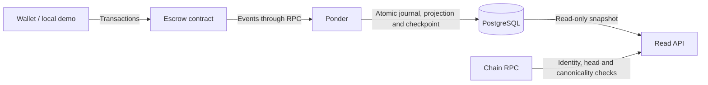

# Remitee escrow challenge

I built a non-custodial ERC-20 escrow with a read API backed by indexed contract events. I chose one contract with multiple escrow IDs to keep deployment and indexing simple. I use Foundry for Solidity tests, Ponder for indexing, PostgreSQL for the projection, and TypeScript for the API.

## Run locally

I package the full setup in Docker: Anvil, PostgreSQL, deployment, indexer and API. With Docker/Compose running, I initialize the pinned submodules and start it with:

```sh
git submodule update --init --depth 1
docker compose --profile app up --build --wait --wait-timeout 120
```

The Docker path needs no host Node, npm, Foundry or `.env` file. The first build downloads the pinned images, dependencies and compiler. Only the API is published, at `http://127.0.0.1:3000`; startup waits for readiness.

```sh
docker compose --profile app run --rm --no-deps demo
curl http://127.0.0.1:3000/health
curl 'http://127.0.0.1:3000/escrows?limit=20'
```

My demo creates four deposits: I cancel one, confirm one, reject one, and let the fourth expire before recovering it. It checks receipts, getters, API results and payout balances. Repeating it creates new IDs. It uses unlocked local accounts and a test-only token; each run advances Anvil's clock by about seven days. `--no-deps` leaves the running services' configuration alone.

I keep Anvil disposable. Restarting only the application preserves the session:

```sh
docker compose --profile app restart application
```

After losing the Anvil session, I deliberately reset the selected project's database and deployment volumes before starting fresh:

```sh
docker compose --profile app down --volumes --remove-orphans
docker compose --profile app up --build --wait --wait-timeout 120
```

## Contract rules

I fund each escrow atomically during creation, after a separate ERC-20 approval. Every resolution requires an authorized transaction while the escrow is Pending:

| Action | Caller | Execution time | Recipient | Final state |
| --- | --- | --- | --- | --- |
| Cancel | Sender | Before creation + 2 hours | Sender | CancelledBySender |
| Confirm | Beneficiary | Before creation + 7 days | Beneficiary | Released |
| Reject | Beneficiary | Before creation + 7 days | Sender | Rejected |
| Recover | Sender | At or after creation + 7 days | Sender | Expired |

I interpret the cancellation window as a limit while Pending. The beneficiary can settle immediately; the first successful resolution wins. A later cancellation cannot undo a release.

I keep expiry passive: time alone never transfers tokens or changes storage. Before recovery, the contract remains Pending and the API derives `ExpiredRecoverable`. Detected transfer failures revert the operation, including status and events. The contract has no owner withdrawal, emergency pause, upgrade or rescue path.

## Architecture and decisions



- I chose Ponder after testing duplicate delivery, interrupted writes, restart and reorganizations. I keep projection rules separate from its persistence adapter; only Ponder writes indexed data.
- I index events after a configurable additional-block delay, default `CONFIRMATION_DELAY=2`: inclusion at block 100 becomes eligible at head 102. This is an admission policy, not consensus finality.
- I let Ponder roll back and replay within a bounded recovery window based on block timestamps, default 180 seconds. I reject unverifiable reads and require an explicit validated replay when recovery is no longer possible.
- I serve rows and checkpoint from one read-only database snapshot, then validate chain/deployment identity and canonical hashes. I expose lag/backlog instead of treating an older canonical prefix as the latest chain state.
- I run Ponder and the API under one launcher, sharing startup context and shutting down the sibling if either exits unexpectedly. I query PostgreSQL directly; I have not added a broker or cache.

## Read API

| GET | Purpose |
| --- | --- |
| `/escrows/{id}` | Detail and observation metadata |
| `/escrows` | Sender/beneficiary/effective-status filters, newest ID first, limit/offset pagination |
| `/health` | RPC/database/indexer readiness, indexed progress and delay |
| `/openapi.yaml` | The canonical [OpenAPI contract](docs/api/openapi.yaml) |

I serialize IDs, amounts, block numbers and Unix-second timestamps as decimal strings. I combine filters before pagination and derive expiry from chain time. A 404 means absence at a verified admitted checkpoint; unavailable verification returns 503. `canCancel` and `canRecover` describe the sender's status/time eligibility; they do not authenticate a caller or guarantee transaction success. [HTTP details](docs/api/README.md).

## Verification

For development checks I use Node 24.14.1/npm 11.11.0 and install with `npm ci`:

```sh
npm run check
npm run contracts:check
npm run indexer:typecheck
npm run indexer:unit
npm run api:spec
npm run api:unit
npm run indexer:test
npm run app:test
npm run contracts:docs
```

I test exact deadlines, authorization, adversarial tokens/reentrancy, real PostgreSQL transaction interruption, replay/reorgs and actual HTTP responses against OpenAPI. The Docker acceptance runs the complete setup and demo in isolated projects. CI invokes these checks.

## Assumptions and limitations

- I assume honest, balance-preserving ERC-20 behavior. SafeERC20 supports standard/no-return conventions, and funding checks the exact received amount. I do not certify arbitrary token economics: outgoing fees, rebasing or dishonest success reports are unsupported; outgoing recipient balances are not rechecked.
- Issuer pauses/blacklists can block every exit, including expiry recovery, indefinitely. The contract cannot bypass them or guarantee unconditional refunds.
- I trust the RPC for complete history. A reorg after the last RPC/SQL check remains possible; no atomic snapshot spans both systems. Indexed API state can lag an already executed transaction.
- I target local/internal consumers. The API is anonymous, read-only and published only on loopback in Compose. It has no transaction submission, wallet UI or production deployment. The deployment/demo commands are explicit local write tools.
- The setup requires a Git checkout with initialized submodules. The chain is ephemeral; incompatible saved state is refused. I have not audited this for production or established throughput/finality guarantees.

## Improvements I would evaluate

- Service authentication and authorization for an actual internal deployment: [#14](https://github.com/dubzn/remitee-challenge/issues/14).
- Caching only after measurement, with canonicality and time-derived eligibility preserved: [#13](https://github.com/dubzn/remitee-challenge/issues/13).
- Asset admission and issuer-control monitoring before supporting real funds.
- Emergency controls/upgrades only after defining authority, exit rights and migration risks: [#8](https://github.com/dubzn/remitee-challenge/issues/8), [#9](https://github.com/dubzn/remitee-challenge/issues/9).

## Reference docs and AI history

I keep the [behavior checklist](docs/sdd/escrow.md), [contract flows](docs/contract-flows.md), [PostgreSQL models](docs/postgres-models.md), [development/recovery guide](docs/development.md) and [NatSpec reference guide](contracts/README.md) separate from this overview.

I used Codex for implementation/verification and Claude for bounded reviews. The [AI appendix](docs/ai-log/README.md) retains historical prompts, responses and planning, separate from current instructions. I remain responsible for the submitted decisions and code.
