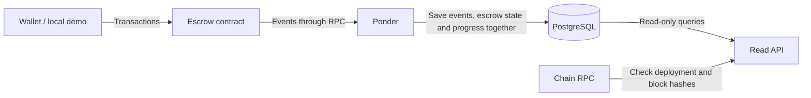

# Remitee escrow challenge

ERC-20 escrow with an event-backed read API. Stack: Solidity, Foundry, Ponder, PostgreSQL and TypeScript.

## Run locally

With Docker/Compose running, initialize the pinned submodules and start Anvil, PostgreSQL, deployment, indexer and API:

```sh
git submodule update --init --depth 1
docker compose --profile app up --build --wait --wait-timeout 120
```

No host Node, npm, Foundry or `.env` file is needed. Startup waits for the API at `http://127.0.0.1:3000`; only this port is published.

Run the lifecycle demo, then query the API:

```sh
docker compose --profile app run --rm --no-deps demo
curl http://127.0.0.1:3000/health
curl 'http://127.0.0.1:3000/escrows?limit=20'
```

The demo checks all four outcomes, expiry before recovery, receipts, getters, API results and payout balances. It uses unlocked local accounts and a test token, advances Anvil by seven days, and creates new IDs each run. `--no-deps` preserves the running configuration.

Restart only the application to preserve the current chain session:

```sh
docker compose --profile app restart application
```

Anvil is ephemeral. After losing its session, reset the selected project's volumes. **This deletes its saved data:**

```sh
docker compose --profile app down --volumes --remove-orphans
docker compose --profile app up --build --wait --wait-timeout 120
```

## Contract rules

One contract manages multiple escrow IDs. Creation funds each escrow atomically after ERC-20 approval. The amount must be positive; the beneficiary cannot be zero, the sender or this escrow. Other contract beneficiaries are allowed.

Every resolution requires an authorized transaction while the escrow is Pending:

| Action | Caller | Execution time | Recipient | Final state |
| --- | --- | --- | --- | --- |
| Cancel | Sender | Before creation + 2 hours | Sender | CancelledBySender |
| Confirm | Beneficiary | Before creation + 7 days | Beneficiary | Released |
| Reject | Beneficiary | Before creation + 7 days | Sender | Rejected |
| Recover | Sender | At or after creation + 7 days | Sender | Expired |

The beneficiary can settle immediately, including during the cancellation window. The first successful resolution wins; a later cancellation cannot undo a release.

Expiry is passive: time alone never transfers tokens. Until recovery, storage remains Pending and the API reports `ExpiredRecoverable`. Detected transfer failures revert the operation. There is no owner withdrawal, pause, upgrade or rescue path.

## Architecture



Ponder is the only writer; event-handling rules are separate from its database adapter. The API reads records and indexing progress together and verifies their block hashes against the chain.

For replaced blocks, Ponder rolls back and reprocesses history within a configurable window: 180 seconds by block timestamps. Unrecoverable mismatches block reads until an explicit rebuild into a fresh database schema. RPC failures return 503 without deleting data. The shared launcher stops both processes if either exits unexpectedly.

## Decisions

| Decision | Alternative | Why / trade-off |
| --- | --- | --- |
| Ponder | A custom RPC polling worker | I chose existing restart, transaction and fork-recovery machinery over maintaining it myself. Local tests covered duplicates, interrupted writes and reorganizations. |
| PostgreSQL | SQLite for a lighter setup | I kept Ponder's PostgreSQL backend and a database service shared by indexer/API containers. SQLite saves a service but needs different storage wiring. |
| `CONFIRMATION_DELAY=2` extra blocks | Immediate indexing, or waiting for network finality | I chose a small local delay to exercise confirmation handling. Block 100 is indexed only after block 102 exists. It reduces exposure to recent forks but does not guarantee finality; it is configurable and has not been tuned for a live network. |
| Immediate beneficiary decisions | An exclusive 2-hour sender cancellation window | I prioritize immediate settlement; the cost is that confirmation can beat cancellation. |
| Reject this escrow as beneficiary | Reject only zero and sender, as required | This contract cannot call its own beneficiary actions. The extra check prevents an escrow whose beneficiary cannot decide; other contracts remain allowed. |
| Exact incoming token amount | Record fee-adjusted deposits | I keep the promised amount equal to the funding, avoiding different deposit/payout amounts. No-return tokens remain supported. |
| No pause or upgrades | Administrator controls or a proxy | I avoided additional authority, exit and migration rules within the challenge. These require separate design. |

## Read API

| GET | Purpose |
| --- | --- |
| `/escrows/{id}` | Detail, transaction hashes and indexing information |
| `/escrows` | Sender/beneficiary/status filters, newest ID first, limit/offset pagination |
| `/health` | Dependency status and last indexed block |
| `/openapi.yaml` | [OpenAPI contract](docs/api/openapi.yaml) |

The API serializes IDs, amounts, block numbers and Unix-second timestamps as decimal strings. Filters run before pagination; expiry uses chain time. Responses include the latest observed block, last indexed block and indexing lag. A 404 means no escrow was found in the indexed blocks; newer transactions may still be waiting. Unverifiable reads return 503.

`canCancel` and `canRecover` describe sender eligibility by recorded status and observed time, without authenticating the caller or guaranteeing transaction success. See [HTTP details](docs/api/README.md).

## Verification

Use Node 24.14.1/npm 11.11.0, install dependencies with `npm ci`, then run:

```sh
npm run check
npm run contracts:check
npm run indexer:typecheck
npm run indexer:unit
npm run api:spec
npm run api:unit
npm run indexer:test
npm run app:test
npm run contracts:docs
```

Checks cover deadlines, authorization, adversarial tokens, reentrancy, write interruption, restart, forks and HTTP/OpenAPI agreement. Docker acceptance runs the full setup/demo in isolated projects.

## Optional work selected

| Addition | Why |
| --- | --- |
| CI — optional in the challenge | I chose repeatable contract, API and Docker checks on pushes and pull requests to catch regressions. Includes Solidity formatting and TypeScript checks. |
| OpenAPI — documentation extra | Response validation keeps the HTTP specification and implementation aligned. Swagger UI is not included. |
| NatSpec + `forge doc` — documentation extra | Rules, deadlines and errors stay alongside the interface and in a generated reference. |

I left the other suggested bonuses out to focus on contract correctness and reproducible local execution.

## Assumptions and limitations

- I assume honest, exact-transfer ERC-20s. Funding checks the amount received; payout recipient balances are not rechecked. Fees, rebasing and dishonest success reports are unsupported.
- Issuer pauses or blacklists can block every exit, including expiry recovery, indefinitely. The contract cannot bypass them or guarantee unconditional refunds.
- I trust the RPC to provide complete history. A reorganization after the last check remains possible; no atomic check spans database and chain. API state can lag transactions.
- I target local/internal consumers. The API is anonymous, read-only and published on loopback in Compose. There is no wallet UI, transaction submission, testnet deployment or production audit.
- Incompatible saved chain/database state is rejected rather than silently reset.

## Improvements I would evaluate

- Service authentication and authorization for an internal deployment: [#14](https://github.com/dubzn/remitee-challenge/issues/14).
- Caching after measurement, preserving block verification and time-based eligibility: [#13](https://github.com/dubzn/remitee-challenge/issues/13).
- Token admission rules and monitoring of issuer restrictions before supporting real funds.
- Pause/upgrades after defining authority, exit rights and migration risks: [#8](https://github.com/dubzn/remitee-challenge/issues/8), [#9](https://github.com/dubzn/remitee-challenge/issues/9).

## Reference docs and AI history

[Behavior checklist](docs/sdd/escrow.md) · [Contract flows](docs/contract-flows.md) · [PostgreSQL models](docs/postgres-models.md) · [Development/recovery](docs/development.md) · [NatSpec guide](contracts/README.md).

Codex assisted with implementation and verification; Claude provided reviews. The [AI appendix](docs/ai-log/README.md) retains historical prompts, responses and planning, separate from current instructions.
