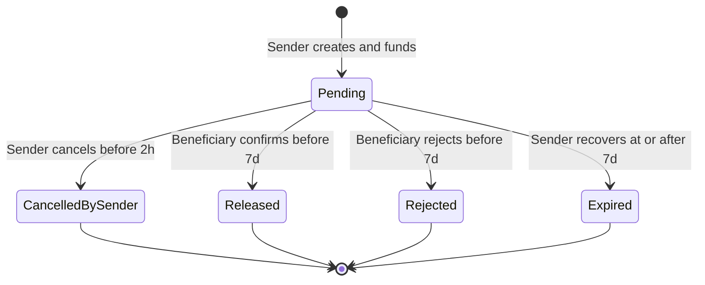
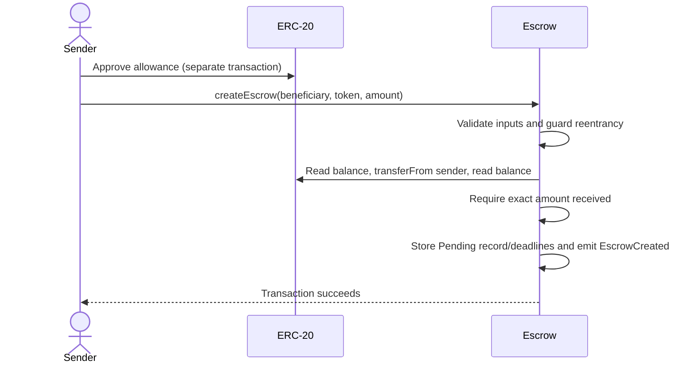
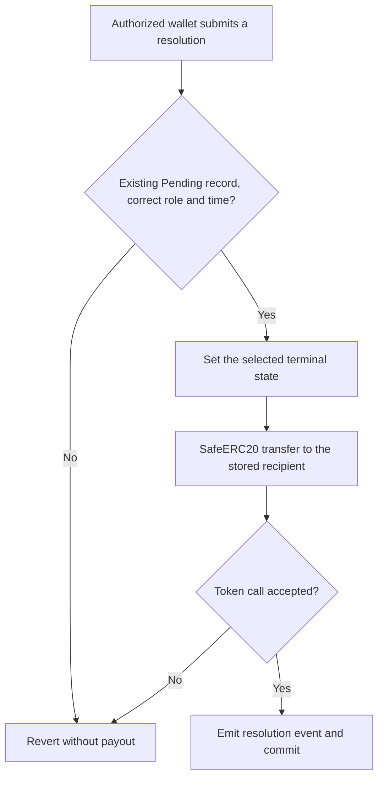

# Contract interactions

I use these diagrams to separate token movement from observation. Every resolution arrow requires a successful authorized transaction; neither the API, indexer nor elapsed time executes a payout. [Rules and trade-offs](../README.md#contract-rules), [interface](../contracts/src/IEscrow.sol).

Confirmation pays the beneficiary. Cancellation, rejection and recovery pay the fixed sender. The first successful resolution wins, including during the cancellation window.

## Funding

A creation failure reverts funding/record/ID changes, but not an earlier separate approval. One deployment holds many IDs; the API does not hold tokens or sign transactions.

## Payout and expiry

Detected reverting/false-returning transfers roll the transaction back to Pending. I assume honest exact-transfer token behavior; a lying success or issuer restriction is not solved by these checks. [Token limitations](../README.md#assumptions-and-limitations).

At exactly 2h, cancellation closes. At exactly 7d, beneficiary decisions close and sender recovery opens. Without recovery, storage remains Pending, tokens stay held and no EscrowExpired event appears. The API derives ExpiredRecoverable using observed chain time. Beneficiary confirmation is a business action; block confirmations are the indexer's configured delay before indexing.
