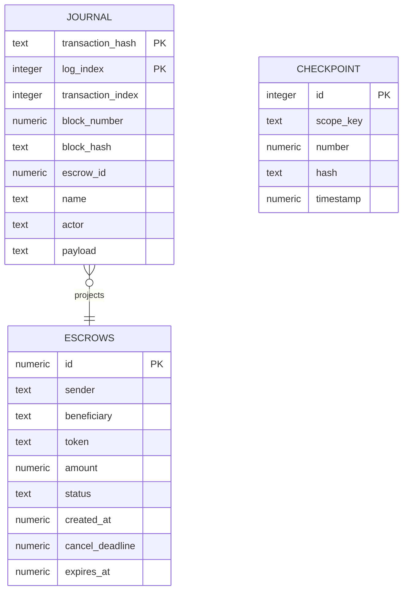

# PostgreSQL projection

I keep one verified deployment/policy scope per schema. Ponder owns durable sync, writer exclusion, transactions, rollback history and schema lifecycle. The application schema is defined in [ponder.schema.ts](../apps/indexer/ponder.schema.ts).

The relationship is logical; the schema defines no foreign key.

| Table | Contents and ownership |
| --- | --- |
| escrows | Deposit parties/asset/amount/deadlines and recorded status. Creation transaction/block/hash are required; resolution transaction/block/hash remain null until a terminal event. Sender+ID and beneficiary+ID indexes support account queries. |
| journal | Primary key `(transaction_hash, log_index)` within the deployment schema. Includes transaction index, block/hash, escrow ID, event name/actor, normalized payload and raw data/topics. Identical replay is a no-op; conflicting content fails. |
| checkpoint | Fixed row ID 1, scope key and last projected block/hash/timestamp. Updated even for empty blocks; it is visible application progress, not a second independent engine cursor. |

The scope key binds deployment identity, confirmation delay, recovery window and projection version. Changing scope does not repoint existing rows. The descriptor pins chain/genesis, contract, deployment receipt/block/hash and runtime codehash.

I use Ponder bigint columns for lossless integer storage and decimal strings at the HTTP boundary. Addresses/hashes normalize to lowercase. I do not narrow uint256 amounts/IDs or uint64 timestamps to JavaScript numbers. Ponder maps camelCase schema names to snake_case SQL columns.

## Writes and reads

Projection rules depend on [ProjectionStore](../apps/indexer/projection.ts); the [Ponder adapter](../apps/indexer/store.ts) writes only through the handler's context.db. Event insertion, legal escrow transition and block checkpoint participate in framework transactions/rollback. A detected missing creation, wrong actor or conflicting resolution fails rather than fabricating a state.

The API uses a separate pg pool with read-only repeatable-read transactions. Required filters run in SQL before limit/offset; eligibility uses one verified head timestamp. No periodic job writes synthetic expiry states.

I never edit Ponder's private metadata or journal/cursor to repair history. Within-window forks use engine rollback; incompatible history/policy or unrecoverable reorg requires explicit validated replay into a fresh scope. [Operational steps](development.md), [assumptions and limitations](../README.md#assumptions-and-limitations).
